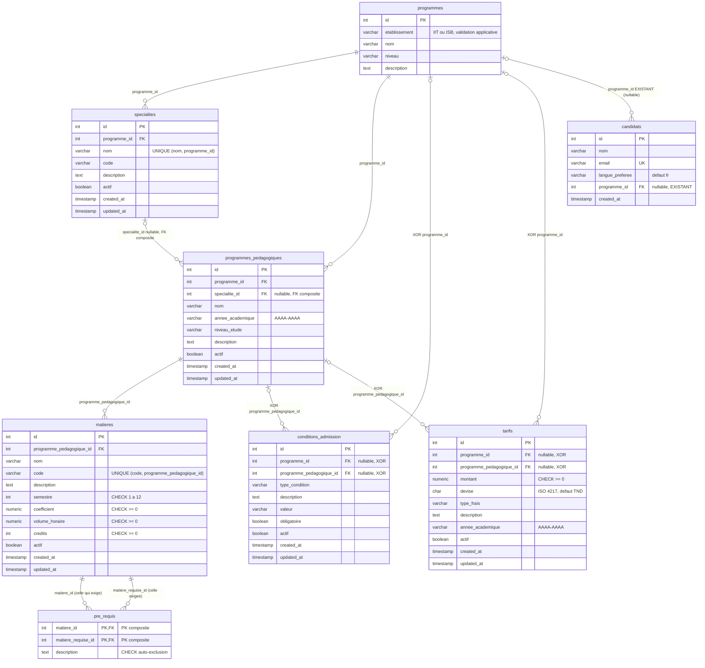

# Task12 — Catalogue académique

| Métadonnée | Valeur |
|---|---|
| **Épic** | US11 — Cœur métier et catalogue |
| **Tâche** | Task12 — Catalogue académique |
| **Statut du document** | Proposition finale soumise à validation |
| **Date** | 2026-11-11 |
| **Type** | Document de conception (aucune exécution SQL, aucune migration, aucune modification de base) |
| **Dépôt** | `SmartCampus-AI` |
| **Équipe d'exécution** | Équipe responsable de US15 (implémentation) — le présent document est livrable documentaire de Task12 |

---

## 1. Présentation et périmètre de Task12

### 1.1 Objectif

Task12 pose la **fondation documentaire et conceptuelle du catalogue académique** de la plateforme SmartCampus AI : programmes, spécialités, programmes pédagogiques, matières, prérequis, conditions d'admission et tarifs.

Le catalogue alimente deux besoins directs :

1. **La consultation côté candidat** — ex. les formations, leurs niveaux, leurs conditions d'admission et leurs frais (futur enrichissement de `/api/formations` et écran de préinscription).
2. **La préinscription** — `candidats.programme_id` rattache déjà un candidat à un programme du catalogue (relation existante en base).

### 1.2 Périmètre inclus

- Dictionnaire de données des **7 tables** du catalogue.
- Spécification des contraintes : PK, FK, UNIQUE, CHECK, nullabilité.
- Relations, cardinalités justifiées par les FK, diagramme ERD Mermaid.
- Règles métier, index recommandés, règles de compatibilité avec l'existant.
- Séparation explicite entre **réel**, **proposé**, **à implémenter (US15)** et **évolutions API**.

### 1.3 Périmètre exclus

- **Aucune exécution de SQL**, aucune migration, aucune modification de `db/init.sql`, aucune modification d'une table ou d'une donnée existante.
- **Aucune modification de code** (Python, API, frontend).
- Aucune nouvelle colonne sur `programmes` (décision A, § 4.1).
- Purge/`ON DELETE CASCADE` sur les données démo : hors périmètre.
- Le volet **documents, versions et RAG** (Task14) : géré séparément, hors du présent catalogue.

### 1.4 Convention de lecture des statuts dans ce document

| Mention | Signification |
|---|---|
| **EXISTANT** | Vérifié en base (lecture `information_schema` / `pg_catalog`) ou dans le code du dépôt. |
| **PROPOSÉ** | Conception retenue par Task12, **à implémenter ultérieurement** par l'équipe US15. |
| **À VALIDER** | Point ouvert soumis à l'équipe (§ Annexe A). |

---

## 2. État réel de la base de données actuelle

*Vérifié le 2026-11-11 par introspection en lecture seule sur le conteneur `smartcampus-db` (PostgreSQL 16.15, extension `vector` 0.8.7, base `smartcampus`).*

### 2.1 Schéma `public` — inventaire complet

Le schéma `public` contient **exactement deux tables** : `programmes` et `candidats`. Aucune des six nouvelles tables du catalogue n'existe (vérifié également sur toutes les branches du dépôt : `main`, `feature/task-7-backend-init`, `feature/epic-10-nourcine`, `origin/epic23-sessions-invites`).

### 2.2 Table `programmes` — structure réelle

| Colonne | Type réel | Nullable | Défaut |
|---|---|---|---|
| `id` | `integer` | NON | `nextval('programmes_id_seq')` (SERIAL) |
| `etablissement` | `character varying(10)` | NON | — |
| `nom` | `character varying(150)` | NON | — |
| `niveau` | `character varying(50)` | NON | — |
| `description` | `text` | OUI | — |

**Contraintes et index réels :**

| Élément | Détail |
|---|---|
| PK | `programmes_pkey PRIMARY KEY (id)` → index unique btree sur `(id)` |
| FK sortantes | aucune |
| FK entrantes | `candidats_programme_id_fkey → programmes(id)` |
| CHECK | **aucune** |
| UNIQUE | **aucune** |
| Autres index | **aucun** (pas d'index sur `etablissement`, `nom`, `niveau`) |
| Volume | 4 lignes (données de démonstration) |

**Validations aujourd'hui purement applicatives** (à ne pas présenter comme existantes en base) :

- `etablissement ∈ {IIT, ISB}` → validateur Pydantic dans `backend/app/schemas/formation.py`.
- Unicité `(nom, etablissement)` → vérifiée en Python (`FormationService._check_duplicate*`) ; **non protégée en base**, donc non sécurisée contre les écritures concurrentes.

### 2.3 Table `candidats` — éléments utiles au catalogue

| Colonne | Type réel | Nullable |
|---|---|---|
| `id` | `integer` (PK) | NON |
| `nom` | `varchar(100)` | NON |
| `email` | `varchar(150)` **UNIQUE** | NON |
| `langue_preferee` | `varchar(20)` DEFAULT `'fr'` | OUI |
| **`programme_id`** | `integer` **FK → `programmes(id)`** | OUI |
| `created_at` | `timestamp` DEFAULT `now()` | OUI |

### 2.4 Points de vigilance constatés en base

1. `candidats.programme_id` est **nullable** : un candidat peut exister sans programme rattaché.
2. Aucun index sur `candidats.programme_id` (PostgreSQL ne crée pas d'index sur les FK) : les jointures et les suppressions de programme scannent la table `candidats`.
3. L'unicité `(nom, etablissement)` n'étant pas en base, deux écritures concurrentes peuvent créer des doublons malgré le contrôle applicatif.

---

## 3. Dictionnaire de données — vue d'ensemble (7 tables)

| # | Table | État | Rôle | PK |
|---|---|---|---|---|
| 1 | `programmes` | **EXISTANT** | Noyau du catalogue : formation proposée (IIT / ISB) | `id` |
| 2 | `specialites` | **PROPOSÉ** | Spécialités rattachées à un programme | `id` |
| 3 | `programmes_pedagogiques` | **PROPOSÉ** | Déclinaison opérationnelle d'un programme (année, niveau, spécialité) | `id` |
| 4 | `matieres` | **PROPOSÉ** | Matières d'un programme pédagogique | `id` |
| 5 | `pre_requis` | **PROPOSÉ** | Lien N:N auto-référentiel entre matières | composite `(matiere_id, matiere_requise_id)` |
| 6 | `conditions_admission` | **PROPOSÉ** | Conditions d'admission, rattachées à un programme **ou** à un programme pédagogique | `id` |
| 7 | `tarifs` | **PROPOSÉ** | Frais / tarifs, même principe de rattachement que les conditions | `id` |

Toutes les tables respectent l'**ASCII snake_case** et n'utilisent que des types PostgreSQL standards (compatibilité Task12 / Task14 / FastAPI / SQLAlchemy / pgvector sans interaction requise).

---

## 4. Spécification détaillée par table

> Aucun bloc de SQL exécutable n'est produit ici : les contraintes sont décrites en tableaux, l'implémentation relève de l'équipe US15 (§ 10.3).

### 4.1 `programmes` — EXISTANT (aucune modification)

**Décision A : conserver strictement les cinq colonnes existantes. Aucune colonne ajoutée dans cette tâche.**

| Colonne | Type | Nullable | PK | FK | Remarque |
|---|---|---|---|---|---|
| `id` | `INTEGER` | NON | ✅ | — | SERIAL, `programmes_pkey` |
| `etablissement` | `VARCHAR(10)` | NON | — | — | valeurs métier `IIT` / `ISB` (règle applicative) |
| `nom` | `VARCHAR(150)` | NON | — | — | |
| `niveau` | `VARCHAR(50)` | NON | — | — | vocabulaire libre : Licence, Prépa, Ingénierie… |
| `description` | `TEXT` | OUI | — | — | |

| Contrainte | État | Commentaire |
|---|---|---|
| PK `(id)` | **EXISTANT** | `programmes_pkey` |
| `UNIQUE (nom, etablissement)` | **NON EXISTANT — validation applicative uniquement** | Python (`_check_duplicate*`) ; une contrainte DB éventuelle est un **ajout ultérieur** nécessitant un dédoublonnage préalable, hors Task12 |
| `CHECK (etablissement IN ('IIT','ISB'))` | **NON EXISTANT — validation applicative uniquement** | Pydantic (`formation.py`) ; idem, ajout ultérieur possible |
| FK entrante `candidats.programme_id` | **EXISTANT** | cardinalité 1:N (§ 5) |

> ⚠️ Les cinq colonnes constituent le **contrat stable** de l'API `/api/formations` (§ 9). Toute évolution future devra être strictement **additive**.

### 4.2 `specialites` — PROPOSÉ

| Colonne | Type | Nullable | PK | FK | Défaut |
|---|---|---|---|---|---|
| `id` | `INTEGER` | NON | ✅ | — | SERIAL |
| `programme_id` | `INTEGER` | NON | — | ✅ → `programmes.id` | — |
| `nom` | `VARCHAR(150)` | NON | — | — | — |
| `code` | `VARCHAR(30)` | NON | — | — | *unicité non imposée par la décision : à valider (Annexe A)* |
| `description` | `TEXT` | OUI | — | — | NULL |
| `actif` | `BOOLEAN` | NON | — | — | `TRUE` |
| `created_at` | `TIMESTAMP` | NON | — | — | `now()` |
| `updated_at` | `TIMESTAMP` | NON | — | — | `now()` |

| Contrainte | Définition | Objectif |
|---|---|---|
| PK | `(id)` | identifiant |
| **UNIQUE** | `(nom, programme_id)` | deux spécialités homonymes interdites **au sein d'un même programme** (homonymie autorisée entre programmes) |
| **UNIQUE d'appui** | `(id, programme_id)` | **requis par la décision B** : cible de la FK composite de `programmes_pedagogiques` (§ 4.3). PostgreSQL exige une contrainte unique sur l'ensemble exact des colonnes référencées par une FK composite ; cet ajout ne duplique aucune donnée (`id` étant déjà unique) |
| FK | `programme_id → programmes.id` | existence du programme parent |

*Règle de suppression recommandée : `RESTRICT` (voir § 11, D5).*

### 4.3 `programmes_pedagogiques` — PROPOSÉ

| Colonne | Type | Nullable | PK | FK | Défaut |
|---|---|---|---|---|---|
| `id` | `INTEGER` | NON | ✅ | — | SERIAL |
| `programme_id` | `INTEGER` | NON | — | ✅ → `programmes.id` | — |
| `specialite_id` | `INTEGER` | **OUI** | — | ✅ **composite** → `specialites(programme_id, id)` | NULL |
| `nom` | `VARCHAR(150)` | NON | — | — | — |
| `annee_academique` | `VARCHAR(9)` | NON | — | — | format `AAAA-AAAA` (voir CHECK) |
| `niveau_etude` | `VARCHAR(50)` | NON | — | — | *vocabulaire à valider : Licence, Master, Prépa, Ingénierie…* |
| `description` | `TEXT` | OUI | — | — | NULL |
| `actif` | `BOOLEAN` | NON | — | — | `TRUE` |
| `created_at` | `TIMESTAMP` | NON | — | — | `now()` |
| `updated_at` | `TIMESTAMP` | NON | — | — | `now()` |

| Contrainte | Définition | Objectif |
|---|---|---|
| PK | `(id)` | identifiant |
| **FK simple** | `programme_id → programmes.id` | garantit l'existence du programme **y compris quand `specialite_id` est NULL** (la FK composite n'est alors pas vérifiée, cf. règle SQL des NULL) |
| **FK composite** | `(programme_id, specialite_id) → specialites(programme_id, id)` | **cohérence d'appartenance** : la spécialité référencée doit appartenir au même programme — une spécialité d'un autre programme est rejetée. Cible = `UNIQUE(id, programme_id)` de § 4.2. `specialite_id NULL` → programme sans spécialité (rattachement direct, décision H) |
| **UNIQUE** | `(programme_id, specialite_id, nom, annee_academique)` **`NULLS NOT DISTINCT`** | évite les doublons d'un même programme pédagogique (décision C). La modalité `NULLS NOT DISTINCT` (PostgreSQL 15+, base en 16) empêche de contourner l'unicité via `specialite_id = NULL` |
| **CHECK** | `annee_academique` conforme au motif `AAAA-AAAA` | intégrité du format d'année |

### 4.4 `matieres` — PROPOSÉ

| Colonne | Type | Nullable | PK | FK | Défaut |
|---|---|---|---|---|---|
| `id` | `INTEGER` | NON | ✅ | — | SERIAL |
| `programme_pedagogique_id` | `INTEGER` | NON | — | ✅ → `programmes_pedagogiques.id` | — |
| `nom` | `VARCHAR(150)` | NON | — | — | — |
| `code` | `VARCHAR(30)` | NON | — | — | — |
| `description` | `TEXT` | OUI | — | — | NULL |
| `semestre` | `INTEGER` | NON | — | — | — |
| `coefficient` | `NUMERIC(4,2)` | NON | — | — | `1` |
| `volume_horaire` | `NUMERIC(5,2)` | NON | — | — | `0` |
| `credits` | `INTEGER` | NON | — | — | `0` |
| `actif` | `BOOLEAN` | NON | — | — | `TRUE` |
| `created_at` | `TIMESTAMP` | NON | — | — | `now()` |
| `updated_at` | `TIMESTAMP` | NON | — | — | `now()` |

| Contrainte | Définition | Objectif |
|---|---|---|
| PK | `(id)` | identifiant |
| **UNIQUE** | `(code, programme_pedagogique_id)` | code de matière unique **au sein d'un programme pédagogique** (décision D) ; homonymie inter-programmes autorisée |
| **CHECK** | `semestre BETWEEN 1 AND 12` | décision D : bornes 1–12 |
| **CHECK** | `coefficient >= 0` | valeur numérique non négative |
| **CHECK** | `volume_horaire >= 0` | valeur numérique non négative |
| **CHECK** | `credits >= 0` | valeur numérique non négative |
| FK | `programme_pedagogique_id → programmes_pedagogiques.id` | rattachement au programme pédagogique |

### 4.5 `pre_requis` — PROPOSÉ

| Colonne | Type | Nullable | PK | FK |
|---|---|---|---|---|
| `matiere_id` | `INTEGER` | NON | ✅ (1ᵉʳ élément) | ✅ → `matieres.id` |
| `matiere_requise_id` | `INTEGER` | NON | ✅ (2ᵉ élément) | ✅ → `matieres.id` |
| `description` | `TEXT` | OUI | — | — |

**Convention de lecture (à respecter dans tout le code) :** la ligne `(matiere_id, matiere_requise_id)` signifie **« `matiere_id` requiert `matiere_requise_id` »**.

| Contrainte | Définition | Objectif |
|---|---|---|
| **PK composite** | `(matiere_id, matiere_requise_id)` | la paire **est** le fait métier : pas d'identifiant séparé, aucune ligne dupliquée possible (décision E) |
| FK ×2 | `matiere_id → matieres.id`, `matiere_requise_id → matieres.id` | les deux extrémités sont des matières |
| **CHECK** | `matiere_id <> matiere_requise_id` | **interdit l'auto-prérequis** (une matière ne peut pas être son propre prérequis) |
| Cycles indirects (A→B→A) | **non exprimable en CHECK** | règle **applicative** : détection de cycle (parcours en profondeur) à l'écriture — voir § 7, R6 |

### 4.6 `conditions_admission` — PROPOSÉ

| Colonne | Type | Nullable | PK | FK | Défaut |
|---|---|---|---|---|---|
| `id` | `INTEGER` | NON | ✅ | — | SERIAL |
| `programme_id` | `INTEGER` | **OUI** | — | ✅ → `programmes.id` | NULL |
| `programme_pedagogique_id` | `INTEGER` | **OUI** | — | ✅ → `programmes_pedagogiques.id` | NULL |
| `type_condition` | `VARCHAR(50)` | NON | — | — | *vocabulaire à valider (Annexe A)* |
| `description` | `TEXT` | NON | — | — | — |
| `valeur` | `VARCHAR(100)` | OUI | — | — | NULL (ex. `"12"`, `"BAC scientifique"`) |
| `obligatoire` | `BOOLEAN` | NON | — | — | `TRUE` |
| `actif` | `BOOLEAN` | NON | — | — | `TRUE` |
| `created_at` | `TIMESTAMP` | NON | — | — | `now()` |
| `updated_at` | `TIMESTAMP` | NON | — | — | `now()` |

| Contrainte | Définition | Objectif |
|---|---|---|
| PK | `(id)` | identifiant |
| **CHECK XOR (parents)** | **exactement un** des deux doit être non nul : `programme_id` **OU** `programme_pedagogique_id`, jamais les deux, jamais aucun (décision F) | la condition appartient soit à un programme, soit à un programme pédagogique |
| FK | `programme_id → programmes.id` / `programme_pedagogique_id → programmes_pedagogiques.id` | existence du parent choisi (la FK portant la valeur NULL n'est pas vérifiée — comportement SQL standard) |
| Colonne `obligatoire` | `BOOLEAN NOT NULL DEFAULT TRUE` | la colonne métier « condition obligatoire » (décision F) est **indépendante** du XOR : elle qualifie la condition, pas son rattachement. *Lecture de « CHECK XOR obligatoire » retenue : contrainte XOR sur les deux parents + colonne `obligatoire` NOT NULL. À confirmer (Annexe A)* |

### 4.7 `tarifs` — PROPOSÉ

| Colonne | Type | Nullable | PK | FK | Défaut |
|---|---|---|---|---|---|
| `id` | `INTEGER` | NON | ✅ | — | SERIAL |
| `programme_id` | `INTEGER` | **OUI** | — | ✅ → `programmes.id` | NULL |
| `programme_pedagogique_id` | `INTEGER` | **OUI** | — | ✅ → `programmes_pedagogiques.id` | NULL |
| `montant` | `NUMERIC(12,2)` | NON | — | — | — |
| `devise` | `CHAR(3)` | NON | — | — | `'TND'` (ISO 4217) |
| `type_frais` | `VARCHAR(50)` | NON | — | — | *vocabulaire à valider (Annexe A)* |
| `description` | `TEXT` | OUI | — | — | NULL |
| `annee_academique` | `VARCHAR(9)` | NON | — | — | format `AAAA-AAAA` |
| `actif` | `BOOLEAN` | NON | — | — | `TRUE` |
| `created_at` | `TIMESTAMP` | NON | — | — | `now()` |
| `updated_at` | `TIMESTAMP` | NON | — | — | `now()` |

| Contrainte | Définition | Objectif |
|---|---|---|
| PK | `(id)` | identifiant |
| **CHECK XOR (parents)** | **exactement un** de `programme_id` / `programme_pedagogique_id` non nul (décision G) | même logique que les conditions d'admission |
| **CHECK** | `montant >= 0` | décision G : montant non négatif |
| **CHECK** | `devise` sur un ensemble de codes ISO 4217 autorisé (proposé : `TND`, `EUR`, `USD`) | *à valider (Annexe A)* |
| **CHECK** | `annee_academique` conforme au motif `AAAA-AAAA` | cohérence avec § 4.3 |
| FK | vers `programmes.id` et `programmes_pedagogiques.id` | parent choisi (NULL non vérifié) |

---

## 5. Relations et cardinalités justifiées

Chaque cardinalité est justifiée par la (ou les) FK réelle(s) et leur nullabilité. Notation : `(min, max)` côté **enfant** / **parent**.

| # | Relation | Cardinalité | Justification (FK) |
|---|---|---|---|
| R1 | `programmes` → `specialites` | **1:N** (un programme a 0..N spécialités ; une spécialité appartient à exactement 1 programme) | `specialites.programme_id NOT NULL FK → programmes.id` |
| R2 | `programmes` → `programmes_pedagogiques` | **1:N** (0..N PP par programme ; 1 programme par PP) | `programmes_pedagogiques.programme_id NOT NULL FK` |
| R3 | `specialites` → `programmes_pedagogiques` | **0..1:N** (un PP référence 0 ou 1 spécialité ; une spécialité décline 0..N PP) | `programmes_pedagogiques.specialite_id **nullable** FK composite → specialites(programme_id, id)` — **0..1 côté parent** car colonne nullable ; la FK composite impose en plus que la spécialité appartienne au même programme que le PP |
| R4 | `programmes_pedagogiques` → `matieres` | **1:N** | `matieres.programme_pedagogique_id NOT NULL FK → programmes_pedagogiques.id` |
| R5 | `matieres` ↔ `matieres` via `pre_requis` | **N:N auto-référentiel** (une matière a 0..N prérequis, est prérequis de 0..N matières) | PK composite `(matiere_id, matiere_requise_id)`, **2 FK** vers `matieres.id`, CHECK d'auto-exclusion |
| R6 | `programmes` → `conditions_admission` | **1:N** | colonne `programme_id NOT NULL` **au sein du couple XOR** (exactement un parent) |
| R7 | `programmes_pedagogiques` → `conditions_admission` | **1:N** | colonne `programme_pedagogique_id` dans le même XOR |
| R8 | `programmes` → `tarifs` | **1:N** | XOR identique à R6 |
| R9 | `programmes_pedagogiques` → `tarifs` | **1:N** | XOR identique à R7 |
| R10 | `programmes` → `candidats` | **1:N EXISTANTE** (0..N candidats par programme ; 1 programme max par candidat) | `candidats.programme_id` **nullable** `FK → programmes.id` — **déjà en production** |

**R6–R9 (modèle XOR) :** une ligne de `conditions_admission` ou de `tarifs` appartient à **exactement un** parent. Côté programme : un programme peut hériter de 0..N lignes ; une ligne référence 0 ou 1 programme. D'où la lecture `0..1` du côté du parent individuel et `0..N` du côté de l'enfant — formalisé en ERD (§ 6) par la cardinalité `|o--o{` et la mention « XOR ».

**Aucune autre relation n'est inventée** : pas de lien direct `candidats ↔ specialites`, `candidats ↔ tarifs` ou `candidats ↔ conditions_admission` (tous transitent par `programmes`).

---

## 6. Diagramme ERD Mermaid



**Légende de notation**

| Symbole | Signification |
|---|---|
| `\|\|` | exactement un |
| `\|o` (côté gauche) / `o\|` (côté droit) | zéro ou un (FK nullable) |
| `}o` (côté gauche) / `o{` (côté droit) | zéro ou plusieurs |
| `PK, FK` | colonne à la fois partie de la PK et d'une FK |
| Mention `XOR` | rattachement exclusif : exactement un des deux parents non nul (§ 4.6, § 4.7) |
| Mention `EXISTANT` | relation déjà en base aujourd'hui |

*Limites de l'ERD Mermaid : les FK composites et les CHECK sont décrits en libellé mais font foi dans les tableaux de § 4. La double relation `matieres ↔ pre_requis` figure volontairement deux fois (deux FK distinctes vers `matieres.id`).*

---

## 7. Règles métier et contraintes d'intégrité

| # | Règle | Niveau | Défense |
|---|---|---|---|
| **R1** | Un programme appartient à un établissement `IIT` ou `ISB` | Applicatif (Pydantic) | *Évolution DB possible ultérieurement : CHECK — non retenue en Task12 (§ 11, D2)* |
| **R2** | L'unicité d'un nom de formation vaut **par établissement** | Applicatif (Python) aujourd'hui | *Contrainte DB ultérieure possible après dédoublonnage — hors Task12* |
| **R3** | Une spécialité appartient à exactement un programme ; son nom est unique dans ce programme | **DB** — `UNIQUE (nom, programme_id)` + FK `NOT NULL` | § 4.2 |
| **R4** | Un programme pédagogique appartient à un programme ; s'il porte une spécialité, **cette spécialité doit appartenir au même programme** | **DB** — FK simple + **FK composite** `(programme_id, specialite_id)` | § 4.3 |
| **R5** | Pas de doublon de programme pédagogique (même programme, même spécialité, même nom, même année) | **DB** — `UNIQUE ... NULLS NOT DISTINCT` | § 4.3 |
| **R6** | Une matière est rattachée à un seul programme pédagogique ; son code y est unique ; `semestre ∈ [1,12]` ; `coefficient`, `volume_horaire`, `credits ≥ 0` | **DB** — UNIQUE + CHECK | § 4.4 |
| **R7** | Une matière ne peut pas être son propre prérequis | **DB** — `CHECK (matiere_id <> matiere_requise_id)` | § 4.5 |
| **R8** | **Pas de cycle de prérequis** (A→B→A) | **Applicatif uniquement** — non exprimable en SQL standard : algorithme de détection de cycle à l'écriture (parcours en profondeur sur le graphe des prérequis) | § 4.5, § 11, D7 |
| **R9** | Une condition d'admission appartient à **exactement un** parent : un programme **ou** un programme pédagogique | **DB** — CHECK XOR + FK | § 4.6 |
| **R10** | Un tarif appartient à **exactement un** parent (même logique XOR) ; `montant ≥ 0` | **DB** — CHECK XOR + CHECK montant | § 4.7 |
| **R11** | Les dates `created_at` / `updated_at` sont renseignées automatiquement | **DB** (défaut `now()`) ; `updated_at` actualisé par mécanisme applicatif ou trigger à implémenter | § 10.3 |
| **R12** | Le drapeau `actif` permet de masquer une entrée **sans la supprimer** (soft flag) | Convention commune des 6 nouvelles tables | § 11, D8 |
| **R13** | Supprimer un programme référencé (candidat, spécialité, PP, condition, tarif) est **interdit** | **DB** — comportement `NO ACTION`/`RESTRICT` des FK entrantes (le DELETE `/api/formations/{id}` renvoie déjà 409 en cas de FK) | § 9, § 11, D5 |

---

## 8. Index recommandés

*Aucun index n'est créé ici : liste destinée à l'équipe US15.*

### 8.1 Index d'unicité (générés automatiquement par les contraintes UNIQUE)

| Table | Colonnes | Origine |
|---|---|---|
| `specialites` | `(nom, programme_id)` | UNIQUE § 4.2 |
| `specialites` | `(id, programme_id)` | UNIQUE d'appui § 4.2 |
| `programmes_pedagogiques` | `(programme_id, specialite_id, nom, annee_academique)` | UNIQUE § 4.3 |
| `matieres` | `(code, programme_pedagogique_id)` | UNIQUE § 4.4 |
| `pre_requis` | `(matiere_id, matiere_requise_id)` | PK composite § 4.5 |
| `programmes`, `specialites`, `programmes_pedagogiques`, `matieres`, `conditions_admission`, `tarifs`, `candidats` | `(id)` | PK |

### 8.2 Index de performance à créer (les FK ne sont pas indexées par PostgreSQL)

| Table | Colonne(s) | Type | Pourquoi |
|---|---|---|---|
| `programmes` | `(etablissement)` | btree | filtre `?etablissement=` de `GET /api/formations` |
| `programmes` | `(niveau)` | btree | filtre `?niveau=` (la requête compare `UPPER(niveau)` : index standard utilisable via expression si aligné — sinon index partiel ou fonctionnel) |
| `programmes` | `(nom)` | btree | recherche `q` (`LIKE '%…%'` : l'index standard ne sert que pour les préfixes — index trigramme à envisager si la recherche devient critique) |
| `candidats` | `(programme_id)` | btree | **FK existante non indexée** : jointures programme→candidats et DELETE de programme |
| `specialites` | `(programme_id)` | btree | FK + filtrage par programme |
| `programmes_pedagogiques` | `(programme_id)` | btree | FK |
| `programmes_pedagogiques` | `(specialite_id)` | btree | FK composite nullable, jointures par spécialité |
| `matieres` | `(programme_pedagogique_id)` | btree | FK |
| `pre_requis` | `(matiere_requise_id)` | btree | **2ᵉ FK** : la PK ne couvre que `matiere_id` en tête ; sans cet index, construire le graphe de prérequis est un scan complet |
| `conditions_admission` | `(programme_id)`, `(programme_pedagogique_id)` | btree | les 2 FK (XOR) |
| `tarifs` | `(programme_id)`, `(programme_pedagogique_id)` | btree | les 2 FK (XOR) |

### 8.3 Pour les tables existantes (ajouts ultérieurs, hors Task12)

| Table | Colonne(s) | Commentaire |
|---|---|---|
| `programmes` | `(nom, etablissement)` | si la décision est prise de basculer l'unicité applicative en contrainte DB (§ 7, R2) — dédoublonnage préalable obligatoire |
| `programmes` | `(etablissement)`, `(niveau)` | déjà listés ci-dessus, utiles dès aujourd'hui à l'API existante |

---

## 9. Compatibilité avec `candidats.programme_id` et l'API `/api/formations`

### 9.1 Contrat API à préserver (inchangé par Task12)

`backend/app/api/routes/formations.py` expose `GET ""`, `GET /{id}`, `POST`, `PUT /{id}`, `DELETE /{id}`. Les schémas Pydantic et les `RETURNING` de `formation_service.py` consomment **exactement** :

```
id, nom, etablissement, niveau, description
```

| Garde-fou | Effet |
|---|---|
| **Décision A** : aucune colonne ajoutée ni modifiée sur `programmes` | Le contrat ci-dessus est **strictement préservé** ; `FormationRead`, `FormationCreate`, `FormationUpdate` et les filtres `etablissement` / `niveau` / `q` / `skip` / `limit` continuent de fonctionner à l'identique. |
| Les 6 nouvelles tables sont **additives** | Aucun endpoint existant n'est modifié ; aucune régression possible sur Task20. |
| Les CHECK XOR / FK n'ajoutent aucune contrainte sur les 5 colonnes | La création, mise à jour et suppression de formations ne change pas de comportement, **sauf** le DELETE : désormais aussi bloqué si des spécialités/PP/conditions/tarifs référencent le programme (comportement déjà anticipé : 409 sur `IntegrityError`). |

### 9.2 Compatibilité avec `candidats.programme_id`

- La FK `candidats.programme_id → programmes(id)` **n'est ni modifiée ni renommée** : les 2 candidats démo et toute donnée existante restent valides.
- `programme_id` reste **nullable** : aucun risque de rupture sur les écritures existantes.
- Nouveauté d'index recommandée : `candidats(programme_id)` (§ 8.2) — améliore les jointures sans changer le comportement.
- **Aucun lien direct** `candidats ↔ specialites / conditions_admission / tarifs` n'est créé : le rattachement transite toujours par `programmes`.

### 9.3 Compatibilité technique

| Cible | Compatibilité |
|---|---|
| PostgreSQL 16 (base réelle) | Tous les types/contraintes prévus sont supportés, y compris `NULLS NOT DISTINCT` (≥ 15) |
| pgvector 0.8.7 | Aucune interaction : le catalogue n'utilise pas de type vectoriel |
| FastAPI / SQLAlchemy | Tables en snake_case = noms de modèles attendus ; `ForeignKeyConstraint` supporte les FK composites ; statuts/drapeaux en types natifs + `CheckConstraint` |
| Task14 (documents) | Périmètre disjoint : aucune table commune, aucune contrainte croisée |
| Alembic (branche epic23) | L'implémentation US15 devra s'inscrire dans le système de migration en place plutôt que de dupliquer `db/init.sql` |

---

## 10. Séparation des responsabilités

### 10.1 Structure réellement existante (constatée, non modifiée)

- `programmes` : 5 colonnes (`id`, `etablissement`, `nom`, `niveau`, `description`), PK, **aucune** UNIQUE, **aucune** CHECK.
- `candidats` : PK, `UNIQUE (email)`, FK `programme_id → programmes(id)` nullable.
- 4 lignes de programmes et 2 lignes de candidats (données démo).
- API `/api/formations` complète et fonctionnelle sur ces 5 colonnes.
- Index : PK uniquement.

### 10.2 Conception proposée par Task12 (présent document)

- Dictionnaire de données des 7 tables (§ 3, § 4).
- Contraintes PK / FK / UNIQUE / CHECK et nullabilités (§ 4).
- Relations et cardinalités justifiées (§ 5), ERD Mermaid (§ 6).
- Règles métier (§ 7), index recommandés (§ 8).
- Règles de compatibilité (§ 9), décisions et justifications (§ 11).

### 10.3 À implémenter ultérieurement par l'équipe responsable de US15

1. Créer les **6 nouvelles tables** (`specialites`, `programmes_pedagogiques`, `matieres`, `pre_requis`, `conditions_admission`, `tarifs`) via le mécanisme de migration en place (Alembic) — **jamais en modifiant `db/init.sql`**.
2. Ajouter les **index** des § 8.2 (dont `candidats(programme_id)`).
3. Implémenter la **gestion de `updated_at`** (trigger ou hook SQLAlchemy).
4. Coder les règles **non exprimables en DB** : détection de cycle des prérequis (R8), vocabulaires `type_condition` / `type_frais` / `niveau_etude` / `devise` si l'équipe valide des listes fermées (Annexe A).
5. Résoudre les points ouverts de l'**Annexe A** avant codage.
6. Éventuellement : ajouter `UNIQUE (nom, etablissement)` et `CHECK (etablissement …)` sur `programmes` — **après** dédoublonnage, en change séparé, hors du présent périmètre.

### 10.4 Évolutions API éventuelles (décision de l'équipe, hors Task12)

- Exposition des nouvelles entités : ex. `GET /api/programmes/{id}/specialites`, `.../tarifs`, `.../conditions-admission`.
- Enrichissement **additif** de `FormationRead` (ne jamais retirer ni renommer les 5 champs existants).
- Filtres complémentaires sur `/api/formations` (ex. `specialite_id`) — à traiter avec l'équipe Task20.
- **Aucune de ces évolutions n'est requise pour clore Task12** : le livrable Task12 est purement documentaire et conceptuel.

---

## 11. Décisions de conception et justifications techniques

| # | Décision | Justification technique |
|---|---|---|
| **D1** | Les 5 colonnes de `programmes` sont **figées** (aucun ajout dans Task12) | Elles constituent le contrat exact de `FormationRead/Create/Update` et des `RETURNING` de `formation_service.py` ; toute évolution non additive casserait Task20 |
| **D2** | `UNIQUE (nom, etablissement)` et `CHECK (etablissement IN (…))` sont décrites comme **applicatives**, pas existantes | Vérification en base : aucune telle contrainte. Les présenter comme existantes mentirait sur l'état du système ; leur passage en DB exige un dédoublonnage préalable (décision explicitement reportée) |
| **D3** | **FK composite** `(programme_id, specialite_id) → specialites(programme_id, id)` + `UNIQUE (id, programme_id)` d'appui | PostgreSQL exige une contrainte unique sur l'ensemble exact des colonnes référencées ; la contrainte d'appui ne duplique aucune donnée. La FK composite **seule** garantit qu'une spécialité étrangère au programme ne puisse être attachée à son PP — protection non obtenable par une FK simple |
| **D4** | **XOR** (exactly-one-parent) pour `conditions_admission` et `tarifs` | Une condition/tarif doit être soit global au programme, soit spécifique à une déclinaison : héritage à deux niveaux sans ambiguïté. La règle est portée par un CHECK DB (impossible à garantir en application seule face à des écritures concurrentes) |
| **D5** | FK en `RESTRICT`/`NO ACTION` (comportement par défaut PG) et **pas** de cascade | Protection du catalogue et de l'historique : une suppression accidentelle de programme ne doit pas effacer en masse candidats/spécialités/PP/conditions/tarifs. Le DELETE API existant expose déjà ce comportement par un 409 |
| **D6** | `pre_requis` avec **PK composite** et sans colonne `id` | Le fait métier est l'**arête** entre deux matières : la paire est naturellement unique, l'`id` séparé ajouterait une redondance et un second point de vérité |
| **D7** | Auto-prérequis interdit en **CHECK**, cycles interdits en **application** | `matiere_id <> matere_requise_id` est un prédicat local exprimable en SQL ; la détection de cycle demande un parcours de graphe — SQL standard ne le fournit pas (CTE récursives possibles mais coûteuses et fragiles : choix applicatif assumé) |
| **D8** | Colonne `actif BOOLEAN` (soft flag) sur les 6 tables nouvelles | Le catalogue doit pouvoir masquer une entrée sans la détruire (cohérence avec la règle « conservation, pas de purge » du projet) ; évite les suppressions physiques bloquées par FK |
| **D9** | `NULLS NOT DISTINCT` sur l'UNIQUE de `programmes_pedagogiques` | Sans elle, plusieurs PP « sans spécialité » (`specialite_id NULL`) au même nom/année passeraient le contrôle : PostgreSQL traite `NULL` comme distinct en UNIQUE classique. Base en PG16 : modalité supportée |
| **D10** | `TIMESTAMP` (sans `TZ`) pour `created_at`/`updated_at` | **Cohérence avec l'existant** (`candidats.created_at` est un `timestamp` sans fuseau). L'alternative `TIMESTAMPTZ` (meilleure pratique) reste ouverte en Annexe A |
| **D11** | `annee_academique` en `VARCHAR(9)` motif `AAAA-AAAA` plutôt qu'en `INTEGER` | Lisibilité métier (`2025-2026`), évite les conversions, permet un CHECK de format explicite |
| **D12** | Aucun SQL exécutable dans ce document | Périmètre de sécurité Task12 : livrable **documentaire** ; l'exécution appartient à US15 avec son propre processus de migration et de revue |
| **D13** | ASCII snake_case strict pour toutes les tables/colonnes | Convention du projet (cohérent avec Task14), compatibilité SQLAlchemy/PostgreSQL sans traduction |

---

## 12. Conclusion et critères de validation de Task12

### 12.1 Conclusion

Task12 livre la **base conceptuelle complète du catalogue académique** : les 7 tables sont spécifiées (colonnes, types, nullabilité, PK, FK, UNIQUE, CHECK), leurs relations et cardinalités sont justifiées par les FK réelles, l'ERD Mermaid est fourni, et la séparation est tranchée entre l'existant vérifié en base, la conception proposée, l'implémentation déléguée à US15 et les évolutions API optionnelles.

Le point central de sécurité est le **non-casse de l'existant** : `programmes` n'est pas modifié, l'API `/api/formations` et la FK `candidats.programme_id` sont préservées à l'identique, et aucune opération de base n'est réalisée dans le cadre de cette tâche.

### 12.2 Critères de validation

| # | Critère | Vérification |
|---|---|---|
| V1 | Document présent à l'emplacement `docs/Task12_Catalogue_Academique.md` | ✅ ce fichier |
| V2 | Dictionnaire de données complet des **7 tables** | ✅ § 3 + § 4 |
| V3 | Colonnes, types, nullabilité, **PK, FK, UNIQUE, CHECK** par table | ✅ § 4.1 → § 4.7 |
| V4 | **Aucune modification** des 5 colonnes de `programmes` | ✅ § 4.1 (décision A) — document uniquement |
| V5 | Validations applicatives **non présentées** comme existantes en base | ✅ § 2.2, § 4.1, D2 |
| V6 | Relations et **cardinalités justifiées par les FK** | ✅ § 5 (R1→R10) |
| V7 | **ERD Mermaid** complet et syntaxiquement valide | ✅ § 6 (8 entités, 12 relations, vérifié) |
| V8 | Règles métier et intégrité, dont les règles **applicatives** (cycles, vocabulaires) explicitement distinguées | ✅ § 7 (R1→R13) |
| V9 | **Index recommandés** (unicité + performance, dont `candidats.programme_id`) | ✅ § 8 |
| V10 | Compatibilité avec `candidats.programme_id` et `/api/formations` | ✅ § 9 |
| V11 | Séparation existant / proposé / US15 / évolutions API | ✅ § 10 |
| V12 | Décisions de conception **justifiées** | ✅ § 11 (D1→D13) |
| V13 | Décisions de modélisation A→H respectées | ✅ vérifié : A (§ 4.1), B (§ 4.2), C (§ 4.3), D (§ 4.4), E (§ 4.5), F (§ 4.6), G (§ 4.7), H (§ 5) |
| V14 | Aucun SQL exécutable, aucune migration, aucune modification de `db/init.sql`, de base ou de code | ✅ § 10.3, D12 |
| V15 | Markdown et Mermaid relus | ✅ relecture finale |

### 12.3 Validation requise avant clôture

- Accord de l'équipe sur les **points ouverts de l'Annexe A** (vocabulaires, index, fuseau horaire).
- Accord sur l'**interprétation de « CHECK XOR obligatoire »** (§ 4.6).
- Prise de connaissance par US15 du périmètre d'implémentation (§ 10.3).

---

## Annexe A — Points restant à valider

| # | Point | Position par défaut du document | Impact |
|---|---|---|---|
| A1 | Vocabulaire fermé de `type_condition` | Aucun CHECK de liste : `VARCHAR(50) NOT NULL` libre | Faible — un CHECK pourra être ajouté ultérieurement |
| A2 | Vocabulaire fermé de `type_frais` | Idem | Idem |
| A3 | Vocabulaire de `niveau_etude` (aligné sur `programmes.niveau` ?) | `VARCHAR(50)` libre | Faible |
| A4 | `devise` : liste ISO restreinte (`TND`, `EUR`, `USD`) ou n'importe quel code à 3 lettres | Liste restreinte proposée | Faible |
| A5 | `specialites.code` : unicité à imposer ? | Non imposé (seule `UNIQUE (nom, programme_id)` l'est par la décision B) | Moyen — si unicité voulue : `UNIQUE (code)` |
| A6 | Lecture de « CHECK XOR obligatoire » | Contrainte XOR sur les 2 parents **+** colonne `obligatoire BOOLEAN NOT NULL` (§ 4.6) | **Moyen** — clarification demandée à l'équipe |
| A7 | `TIMESTAMP` vs `TIMESTAMPTZ` pour les colonnes de suivi | `TIMESTAMP` par cohérence avec `candidats.created_at` (D10) | Faible |
| A8 | Index de recherche plein texte sur `programmes.nom` (trigramme pour `q`) | Index simple recommandé, trigramme « à envisager » (§ 8.2) | Faible |
| A9 | Mise à jour de `updated_at` : trigger DB ou hook applicatif | Non tranché (§ 10.3) | Faible — arbitrage US15 |
| A10 | Passage éventuel de `UNIQUE (nom, etablissement)` et du CHECK `etablissement` en contraintes DB | Explicitement hors périmètre Task12 (§ 10.3, R2) | Reporté |

---

## Annexe B — Journal de conformité (contraintes de la tâche)

| Contrainte imposée | Constat |
|---|---|
| Vérification de `git status` et des fichiers `docs/` avant création | ✅ fait : `docs/` n'existait pas, aucun livrable Task12 présent, modifications non commitées d'un autre membre identifiées et **non touchées** |
| Création limitée à `docs/Task12_Catalogue_Academique.md` | ✅ **un seul fichier créé**, aucun autre fichier créé, modifié ni supprimé |
| Aucune modification de `db/init.sql` | ✅ non touché |
| Aucune migration, aucune modification de table ni de donnée | ✅ aucune opération d'écriture exécutée |
| Aucun SQL exécutable dans le livrable | ✅ contraintes décrites en tableaux uniquement |
| Aucune modification de fichier Python / API / frontend | ✅ aucun fichier code créé ou modifié |
| Aucun travail d'un autre membre touché | ✅ diff existant sur `backend/app/main.py` et fichiers non suivis laissés intacts |
| Aucun commit, push ni merge | ✅ aucun |
| Aucun `.env` ni secret affiché | ✅ aucun |
| Aucun document existant écrasé | ✅ aucun document existant |
