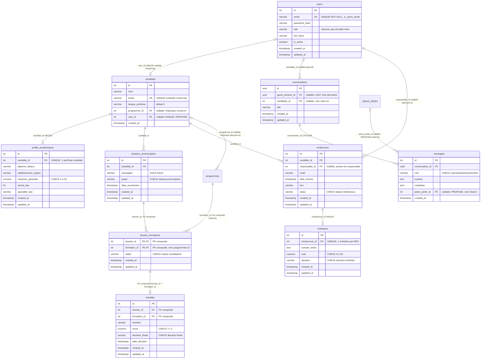

# Task13 — Conception des utilisateurs et des candidatures

| Métadonnée | Valeur |
|---|---|
| **Épic** | US11 — Cœur métier et candidatures |
| **Tâche** | Task13 — Conception des utilisateurs et des candidatures |
| **Statut du document** | Proposition finale soumise à validation |
| **Date** | 2026-11-11 |
| **Type** | Document de conception (aucune exécution SQL, aucune migration, aucune modification de base) |
| **Dépôt** | `SmartCampus-AI` (branche courante `feature/epic-10-nourcine`) |
| **Documents voisins** | `docs/Task12_Catalogue_Academique.md` (catalogue), conception Task14 (documents et pièces jointes) |

---

## 1. Présentation et périmètre de Task13

### 1.1 Objectif

Task13 pose la **conception documentaire du domaine identité et candidature** : comptes utilisateurs, candidats, profils académiques, dossiers de préinscription, candidatures à des formations, conversations/messages, rendez-vous, entretiens et résultats.

### 1.2 Entités couvertes

`users`, `candidats`, `profils_academiques`, `dossiers_preinscription`, `dossier_formations`, `conversations`, `messages`, `rendezvous`, `entretiens`, `resultats`.

**Dépendance externe :** `pieces_jointes` (définie dans **Task14**) — référencée par `messages.piece_jointe_id` mais **non redéfinie** ici.

### 1.3 Périmètre exclus

- **Mécanismes JWT, sessions, `guest_sessions`, `get_current_user`, `require_role`** → **US27** (existants sur la branche `epic23`, hors périmètre de ce document, § 10.4).
- **Catalogue académique** → Task12 (`programmes` et ses 6 tables ; seule la cible `programmes.id` est référencée ici).
- **Documents, versions, traitements, tags, synchronisation** → Task14.
- **Aucune exécution de SQL**, aucune migration, aucune modification de `db/init.sql`, de la base, du code API ou du frontend.
- **Aucune table `roles`** : le rôle reste une colonne `users.role` (décision 3).

### 1.4 Convention de lecture

| Mention | Signification |
|---|---|
| **EXISTANT** | Vérifié en base live ou sur la branche `origin/epic23-sessions-invites` (branche **non fusionnée**, constatée par `git show`, sans checkout). |
| **PROPOSÉ** | Conception Task13 **à implémenter ultérieurement** — **n'existe pas encore** : ne doit jamais être présenté comme existant. |
| **US15 / US27** | Équipes d'implémentation respectives (données / auth-session). |
| **À VALIDER** | Point ouvert soumis à l'équipe (Annexe A). |

---

## 2. État réel

### 2.1 Base live (conteneur `smartcampus-db`, PostgreSQL 16 + pgvector, lecture seule)

Le schéma `public` contient **exactement deux tables** : `programmes` et `candidats`.

**`candidats` — structure réelle :**

| Colonne | Type réel | Nullable | Défaut |
|---|---|---|---|
| `id` | `integer` | NON | `nextval('candidats_id_seq')` (SERIAL) |
| `nom` | `varchar(100)` | NON | — |
| `email` | `varchar(150)` | NON | — |
| `langue_preferee` | `varchar(20)` | OUI | `'fr'` |
| `programme_id` | `integer` | OUI | — |
| `created_at` | `timestamp` | OUI | `now()` |

**Contraintes réelles de `candidats` :**

| Contrainte | Définition |
|---|---|
| `candidats_pkey` | `PRIMARY KEY (id)` |
| **`candidats_email_key`** | **`UNIQUE (email)` — EXISTANT en base live, conservé tel quel (décision 1)** |
| `candidats_programme_id_fkey` | `FOREIGN KEY (programme_id) REFERENCES programmes(id)` (nullable) |

**Aucune autre table du périmètre n'existe en base live** : pas de `users`, `profils_academiques`, `dossiers_preinscription`, `dossier_formations`, `conversations`, `messages`, `rendezvous`, `entretiens`, `resultats`, `pieces_jointes`, ni table `roles`.

### 2.2 Modèles de la branche `origin/epic23-sessions-invites` (NON FUSIONNÉE)

> ⚠️ **Cette branche n'est pas fusionnée dans la branche courante `feature/epic-10-nourcine`** (vérifié : `git log` de la branche courante s'arrête à `5d35aa3`, aucun commit epic23 ; `backend/alembic/` **n'existe pas** sur la branche courante). Les structures ci-dessous existent **uniquement sur cette branche distante**, constatées par `git show` sans checkout. Elles constituent le **socle à réutiliser, pas à réécrire** (décision 4).

**Migration Alembic** `0b68f51fe976_creation_des_tables_epic23.py` + modèles SQLAlchemy (`app/db/models/`) :

**`users` (EXISTANT sur epic23) :**

| Colonne | Type | Nullable | Défaut / contrainte |
|---|---|---|---|
| `id` | `INTEGER` | NON | PK |
| `email` | `VARCHAR(255)` | NON | **index unique `ix_users_email` → UNIQUE NOT NULL (décision 1 users)** |
| `password_hash` | `VARCHAR(255)` | NON | — |
| `role` | `VARCHAR(20)` | NON | défaut `'candidate'` — **colonne conservée, pas de table `roles` (décision 3)** |
| `full_name` | `VARCHAR(200)` | OUI | — |
| `is_active` | `BOOLEAN` | NON | défaut `TRUE` |
| `created_at` / `updated_at` | `TIMESTAMPTZ` | NON | `now()` |

**`conversations` (EXISTANT sur epic23) :**

| Colonne | Type | Nullable | Contrainte |
|---|---|---|---|
| `id` | `UUID` | NON | PK, défaut `gen_random_uuid()` |
| `guest_session_id` | `UUID` | OUI | FK → `guest_sessions.id` ON DELETE SET NULL *(table hors périmètre — US27)* |
| `candidate_id` | `INTEGER` | OUI | FK → `users.id` ON DELETE SET NULL |
| `title` | `VARCHAR(200)` | OUI | — |
| `created_at` / `updated_at` | `TIMESTAMPTZ` | NON | `now()` |

CHECK : `ck_conversations_has_owner` — `guest_session_id IS NOT NULL OR candidate_id IS NOT NULL`. Index : `(candidate_id, updated_at)`, `(guest_session_id)`.

**`messages` (EXISTANT sur epic23) :**

| Colonne | Type | Nullable | Contrainte |
|---|---|---|---|
| `id` | `INTEGER` | NON | PK |
| `conversation_id` | `UUID` | NON | FK → `conversations.id` ON DELETE CASCADE |
| `role` | `VARCHAR(10)` | NON | CHECK `ck_messages_role` : `IN ('user','assistant','system','tool')` |
| `content` | `TEXT` | NON | — |
| `metadata` | `JSONB` | NON | défaut `'{}'::jsonb` |
| `created_at` | `TIMESTAMPTZ` | NON | `now()` |

Index : `(conversation_id, created_at)`.

**Également sur epic23, hors périmètre Task13 (US27) :** `guest_sessions` (UUID PK, `claimed_by → users.id`, index partiels), `conversation_profiles` (PK = `conversation_id`, JSONB), routes `auth.py`, `core/security.py` (JWT HS256), `core/dependencies.py` (`get_current_user`, `require_role`).

**`require_role`** est défini mais **jamais appelé** ailleurs que dans `dependencies.py` : le vocabulaire des rôles effectivement utilisé se limite à `candidate` (défaut d'inscription) → **référentiel à valider (Annexe A2)**.

### 2.3 Points de vigilance

1. **`candidats.email` porte déjà `UNIQUE (email)`** en base live : la décision « sans UNIQUE pour compatibilité » est levée au profit de la **réalité constatée** — la contrainte est **conservée, jamais supprimée** (décision 1).
2. **Deux tables d'identité coexistent** : `candidats` (live, données démo sans compte) et `users` (epic23, comptes auth) — lien proposé en § 4.2 (décision 2).
3. Les identifiants sont **hétérogènes** (`INTEGER` vs `UUID`) : les nouveaux doivent **respecter le type exact de la PK référencée** (décision 7), sans uniformisation.
4. `messages`/`conversations` **existent déjà** : Task13 ne les recrée pas, il propose un **ajout de colonne** sur `messages` (décision 5).

---

## 3. Dictionnaire de données — vue d'ensemble

| # | Table | Statut | Rôle | PK |
|---|---|---|---|---|
| 1 | `users` | **EXISTANT** (epic23) | Compte authentifié ; rôle en colonne | `id` INTEGER |
| 2 | `candidats` | **EXISTANT** (live) | Fiche candidat historique/démo | `id` INTEGER |
| 3 | `profils_academiques` | **PROPOSÉ** | Parcours académique d'un candidat (1:1) | `id` INTEGER |
| 4 | `dossiers_preinscription` | **PROPOSÉ** | Processus réel de candidature | `id` INTEGER |
| 5 | `dossier_formations` | **PROPOSÉ** | Candidature du dossier à une formation | **composite `(dossier_id, formation_id)`** |
| 6 | `conversations` | **EXISTANT** (epic23) | Conversations du chatbot | `id` UUID |
| 7 | `messages` | **EXISTANT** (epic23) | Messages d'une conversation | `id` INTEGER |
| 8 | `rendezvous` | **PROPOSÉ** | Rendez-vous (porteur du responsable) | `id` INTEGER |
| 9 | `entretiens` | **PROPOSÉ** | Entretien adossé à un rendez-vous | `id` INTEGER |
| 10 | `resultats` | **PROPOSÉ** | Résultat d'une candidature | `id` INTEGER |
| — | `pieces_jointes` | **externe Task14** | Cible de `messages.piece_jointe_id` — **non redéfinie ici** | (voir Task14) |

**Identifiants (décision 7) :** `users.id`, `candidats.id`, `messages.id` = `INTEGER` ; `conversations.id` = `UUID`. **Toute nouvelle FK respecte le type exact de sa PK cible.**

---

## 4. Spécification détaillée par table

> Aucun bloc de SQL exécutable : les contraintes sont décrites en tableaux ; l'implémentation revient à US15/US27 selon § 10.

### 4.1 `users` — EXISTANT (branche epic23, non fusionnée) — aucune modification de structure

| Colonne | Type | Nullable | PK | FK | Défaut |
|---|---|---|---|---|---|
| `id` | `INTEGER` | NON | ✅ | — | SERIAL |
| `email` | `VARCHAR(255)` | NON | — | — | **UNIQUE via `ix_users_email` (décision 1)** |
| `password_hash` | `VARCHAR(255)` | NON | — | — | — |
| `role` | `VARCHAR(20)` | NON | — | — | `'candidate'` — **colonne conservée, PAS de table `roles` (décision 3)** |
| `full_name` | `VARCHAR(200)` | OUI | — | — | NULL |
| `is_active` | `BOOLEAN` | NON | — | — | `TRUE` |
| `created_at` / `updated_at` | `TIMESTAMPTZ` | NON | — | — | `now()` |

**Vocabulaire des rôles — référentiel à valider (Annexe A2) :**

| Rôle | État | Usage |
|---|---|---|
| `candidate` | **EXISTANT** (défaut d'inscription epic23) | Candidat |
| `responsable` | PROPOSÉ à valider | Responsable d'entretien / agent — **porté par `rendezvous.responsable_id` (§ 4.8)** |
| `admin` | PROPOSÉ à valider | Administrateur du catalogue et des dossiers |

*Le document n'invente **aucune contrainte CHECK sur `role`** tant que le référentiel n'est pas validé.*

### 4.2 `candidats` — EXISTANT (base live) + évolution proposée

| Colonne | Type | Nullable | PK | FK | Statut |
|---|---|---|---|---|---|
| `id` | `INTEGER` | NON | ✅ | — | EXISTANT |
| `nom` | `VARCHAR(100)` | NON | — | — | EXISTANT |
| `email` | `VARCHAR(150)` | NON | — | — | EXISTANT — **`UNIQUE (email)` conservée (décision 1)** |
| `langue_preferee` | `VARCHAR(20)` | OUI | — | — | EXISTANT, défaut `'fr'` |
| `programme_id` | `INTEGER` | OUI | — | ✅ → `programmes.id` | EXISTANT — **conservée pour compatibilité historique (décision 6)** |
| `created_at` | `TIMESTAMP` | OUI | — | — | EXISTANT |
| **`user_id`** | `INTEGER` | **OUI** | — | ✅ → `users.id` **(type INTEGER = type de la PK cible, décision 7)** | **PROPOSÉ (décision 2)** — `UNIQUE` |

| Contrainte | Définition | Statut |
|---|---|---|
| PK | `(id)` | EXISTANT |
| **UNIQUE `(email)`** | `candidats_email_key` | **EXISTANT en base live — conservé, non supprimé (décision 1)** |
| FK `programme_id` → `programmes(id)` | nullable | EXISTANT — **conservée telle quelle (décision 6)** |
| **FK `user_id` → `users.id`** | nullable + **`UNIQUE (user_id)`** | **PROPOSÉ (décision 2)** |

**Règle de la relation (décision 2) :** `user_id NULL` = candidat ancien **sans compte** (données démo conservées) ; `user_id` renseigné = candidat lié à un compte `users`. **`UNIQUE (user_id)` garantit 1 compte → max 1 fiche candidat.** *Aucune modification des colonnes existantes.*

### 4.3 `profils_academiques` — PROPOSÉ (décision 10)

| Colonne | Type | Nullable | PK | FK |
|---|---|---|---|---|
| `id` | `INTEGER` | NON | ✅ | — |
| `candidat_id` | `INTEGER` | NON | — | ✅ → `candidats.id` (INTEGER, décision 7) |
| `diplome_obtenu` | `VARCHAR(150)` | OUI | — | — |
| `etablissement_origine` | `VARCHAR(150)` | OUI | — | — |
| `moyenne_generale` | `NUMERIC(4,2)` | OUI | — | — `CHECK (moyenne_generale >= 0 AND moyenne_generale <= 20)` *à valider* |
| `annee_bac` | `INTEGER` | OUI | — | — |
| `specialite_bac` | `VARCHAR(150)` | OUI | — | — |
| `created_at` / `updated_at` | `TIMESTAMPTZ` | NON | — | — `now()` |

| Contrainte | Définition |
|---|---|
| PK | `(id)` |
| **FK + UNIQUE** | **`candidat_id → candidats.id`, `UNIQUE (candidat_id)` → 1 profil par candidat (décision 10)** |
| CHECK | bornes de moyenne (proposition, Annexe A5) |

### 4.4 `dossiers_preinscription` — PROPOSÉ

| Colonne | Type | Nullable | PK | FK |
|---|---|---|---|---|
| `id` | `INTEGER` | NON | ✅ | — |
| `candidat_id` | `INTEGER` | NON | — | ✅ → `candidats.id` |
| `campagne` | `VARCHAR(9)` | NON | — | — format `AAAA-AAAA` (CHECK, cf. Task12) |
| `statut` | `VARCHAR(20)` | NON | — | — défaut `'brouillon'`, **CHECK `IN ('brouillon','soumis','en_etude','accepte','refuse','retire')` (vocabulaire à valider, Annexe A4)** |
| `date_soumission` | `TIMESTAMPTZ` | OUI | — | — |
| `created_at` / `updated_at` | `TIMESTAMPTZ` | NON | — | — `now()` |

| Contrainte | Définition |
|---|---|
| PK | `(id)` |
| FK | `candidat_id → candidats.id` (NOT NULL) |
| CHECK | `campagne` motif `AAAA-AAAA` ; `statut` dans le vocabulaire ci-dessus |

**Rôle (décision 6) :** le dossier est **le processus réel de candidature** ; `candidats.programme_id` reste un rattachement historique. *Aucune suppression ni modification de colonne existante.* Ce dossier est aussi la **cible de `justificatifs_candidats` (Task14)** — relation 1:N définie dans Task14, référencée ici sans être redéfinie.

### 4.5 `dossier_formations` — PROPOSÉ (décision 8)

| Colonne | Type | Nullable | PK | FK |
|---|---|---|---|---|
| `dossier_id` | `INTEGER` | NON | ✅ | ✅ → `dossiers_preinscription.id` |
| `formation_id` | `INTEGER` | NON | ✅ | ✅ → **`programmes.id` (cible réelle vérifiée, Task12)** |
| `statut` | `VARCHAR(20)` | NON | — | — défaut `'en_attente'`, **CHECK `IN ('en_attente','en_etude','accepte','refuse','liste_attente')` (à valider, Annexe A4)** |
| `created_at` / `updated_at` | `TIMESTAMPTZ` | NON | — | — `now()` |

| Contrainte | Définition |
|---|---|
| **PK composite** | **`(dossier_id, formation_id)` (décision 8)** — pas de colonne `id` : la paire **est** le fait métier, aucun doublon possible |
| FK | `dossier_id → dossiers_preinscription.id` ; **`formation_id → programmes.id`** (Task12) |
| Index d'appui | `(formation_id)` pour les jointures programme → candidatures (§ 8) |

**Note de typage (décision 7) :** les deux FK sont `INTEGER`, conformes aux PK cibles `dossiers_preinscription.id` et `programmes.id` (SERIAL).

### 4.6 `conversations` — EXISTANT (epic23) — aucune recréation

Colonnes, types (`id UUID PK`), CHECK `ck_conversations_has_owner`, index : **§ 2.2, à réutiliser à l'identique (décision 4).**

- `candidate_id INTEGER → users.id` : **type conforme** (décision 7).
- **Évolution proposée : aucune.** La relation vers Task13 est déjà correcte (conversation → compte candidat via `users`).
- `guest_session_id` et `guest_sessions` : **hors périmètre (US27)**.

### 4.7 `messages` — EXISTANT (epic23) + UN ajout PROPOSÉ (décision 5)

| Colonne | Type | Nullable | PK | FK | Statut |
|---|---|---|---|---|---|
| `id` | `INTEGER` | NON | ✅ | — | EXISTANT |
| `conversation_id` | `UUID` | NON | — | ✅ → `conversations.id` (UUID conforme, décision 7) | EXISTANT |
| `role` | `VARCHAR(10)` | NON | — | — | EXISTANT, CHECK `IN ('user','assistant','system','tool')` |
| `content` | `TEXT` | NON | — | — | EXISTANT |
| `metadata` | `JSONB` | NON | — | — | EXISTANT |
| `created_at` | `TIMESTAMPTZ` | NON | — | — | EXISTANT |
| **`piece_jointe_id`** | **`INTEGER`** | **OUI** | — | **✅ → `pieces_jointes.id` (PK Task14 : INTEGER — conforme, décision 7)** | **PROPOSÉ (décision 5)** |

| Contrainte | Définition | Statut |
|---|---|---|
| PK `(id)`, FK `conversation_id`, CHECK `role`, index `(conversation_id, created_at)` | tels quels | EXISTANT — **ne pas recréer** |
| **FK `piece_jointe_id → pieces_jointes.id`**, nullable, ON DELETE SET NULL *recommandé* | **PROPOSÉ** | **PROPOSÉ** — dépendance **externe Task14** : `pieces_jointes` doit exister **avant** cet ALTER (ordre d'implémentation § 10.3) |

**`pieces_jointes` n'est pas redéfinie ici** : table distincte de `documents` (Task14), colonnes définies par Task14 (`id`, chemin relatif, `mime_type`, `taille`, `uploaded_by → users.id`, `created_at`).

### 4.8 `rendezvous` — PROPOSÉ

| Colonne | Type | Nullable | PK | FK |
|---|---|---|---|---|
| `id` | `INTEGER` | NON | ✅ | — |
| `candidat_id` | `INTEGER` | NON | — | ✅ → `candidats.id` |
| `responsable_id` | `INTEGER` | **OUI** | — | ✅ → `users.id` (**porteur du responsable, décision 9**) |
| `motif` | `VARCHAR(100)` | NON | — | — |
| `date_horaire` | `TIMESTAMPTZ` | NON | — | — |
| `lieu` | `VARCHAR(150)` | OUI | — | — |
| `statut` | `VARCHAR(20)` | NON | — | — défaut `'planifie'`, **CHECK `IN ('planifie','confirme','annule','realise')` (à valider, Annexe A4)** |
| `created_at` / `updated_at` | `TIMESTAMPTZ` | NON | — | — `now()` |

| Contrainte | Définition |
|---|---|
| PK | `(id)` |
| FK | `candidat_id → candidats.id` ; **`responsable_id → users.id` (INTEGER conforme)** |
| CHECK | `date_horaire` dans le futur *à la création* (règle applicative, Annexe A6) |

**Règle centrale (décision 9) :** **le responsable d'entretien est référencé depuis `rendezvous`, jamais depuis `entretiens`.**

### 4.9 `entretiens` — PROPOSÉ (décision 9)

| Colonne | Type | Nullable | PK | FK |
|---|---|---|---|---|
| `id` | `INTEGER` | NON | ✅ | — |
| `rendezvous_id` | `INTEGER` | NON | — | ✅ → `rendezvous.id` |
| `compte_rendu` | `TEXT` | OUI | — | — |
| `note` | `NUMERIC(4,2)` | OUI | — | — `CHECK (note >= 0 AND note <= 20)` *à valider* |
| `decision` | `VARCHAR(20)` | OUI | — | — **CHECK `IN ('favorable','defavorable','a_completer')` (à valider, Annexe A4)** |
| `created_at` / `updated_at` | `TIMESTAMPTZ` | NON | — | — `now()` |

| Contrainte | Définition |
|---|---|
| PK | `(id)` |
| **FK + UNIQUE** | **`rendezvous_id → rendezvous.id`, `UNIQUE (rendezvous_id)` → 1 entretien max par rendez-vous (décision 9)** |
| Responsable | **absent de cette table** : accessible via `rendezvous.responsable_id` (jointure `entretiens → rendezvous → users`) |

### 4.10 `resultats` — PROPOSÉ (décision 8)

| Colonne | Type | Nullable | PK | FK |
|---|---|---|---|---|
| `id` | `INTEGER` | NON | ✅ | — |
| `dossier_id` | `INTEGER` | NON | — | ✅ → `dossiers_preinscription.id` |
| `formation_id` | `INTEGER` | NON | — | ✅ → `programmes.id` |
| `mention` | `VARCHAR(50)` | OUI | — | — *vocabulaire à valider (Annexe A3)* |
| `score` | `NUMERIC(6,2)` | OUI | — | — `CHECK (score >= 0)` |
| `decision_finale` | `VARCHAR(20)` | NON | — | — défaut `'en_attente'`, **CHECK `IN ('en_attente','admisse','liste_attente','refuse')` (à valider, Annexe A4)** |
| `date_decision` | `TIMESTAMPTZ` | OUI | — | — |
| `created_at` / `updated_at` | `TIMESTAMPTZ` | NON | — | — `now()` |

| Contrainte | Définition |
|---|---|
| PK | `(id)` |
| **FK composite** | **`(dossier_id, formation_id) → dossier_formations(dossier_id, formation_id)` — le résultat référence le couple de candidature, pas une ligne isolée (décision 8)** |
| **Pas de `candidat_id`** | **aucune colonne candidat : le candidat est atteint par transit `resultats → dossier_formations → dossiers_preinscription → candidats` (décision 8, non redondant)** |

---

## 5. Relations et cardinalités justifiées

| # | Relation | Cardinalité | Justification (FK réelle) |
|---|---|---|---|
| R1 | `users` ↔ `candidats` | **1:0..1** (un compte → 0 ou 1 fiche candidat ; un candidat → 0 ou 1 compte) | `candidats.user_id` **nullable + UNIQUE** (PROPOSÉ, décision 2) |
| R2 | `candidats` → `profils_academiques` | **1:0..1** | `profils_academiques.candidat_id` NOT NULL **UNIQUE** (décision 10) |
| R3 | `candidats` → `dossiers_preinscription` | **1:N** | `dossiers_preinscription.candidat_id NOT NULL` |
| R4 | `dossiers_preinscription` → `dossier_formations` | **1:N** | PK partie `dossier_id` NOT NULL |
| R5 | `programmes` → `dossier_formations` | **1:N** | PK partie `formation_id NOT NULL → programmes.id` (Task12) |
| R6 | `dossier_formations` → `resultats` | **1:0..1** | FK composite `(dossier_id, formation_id)` (décision 8) |
| R7 | `users` → `conversations` | **1:N (0..N)** | `conversations.candidate_id → users.id` nullable (EXISTANT epic23) |
| R8 | `conversations` → `messages` | **1:N** | `messages.conversation_id NOT NULL → conversations.id` CASCADE (EXISTANT) |
| R9 | `pieces_jointes` → `messages` | **1:0..N** | `messages.piece_jointe_id` **nullable** (PROPOSÉ Task13/Task14) |
| R10 | `candidats` → `rendezvous` | **1:N** | `rendezvous.candidat_id NOT NULL` |
| R11 | `users` → `rendezvous` (responsable) | **1:N (0..N)** | `rendezvous.responsable_id` **nullable** (décision 9 : le responsable vit ici) |
| R12 | `rendezvous` → `entretiens` | **1:0..1** | `entretiens.rendezvous_id` NOT NULL **UNIQUE** (décision 9) |
| R13 | `candidats` → `programmes` (legacy) | **1:0..1** | `candidats.programme_id` **nullable, EXISTANT, conservé** (décision 6) |
| R14 | `users` → `guest_sessions` / `conversations → guest_sessions` | hors périmètre | **US27** (EXISTANT epic23, mentionné sans développement) |

**Justifications clés :** R1 nullable+UNIQUE = compatibilité des anciens candidats sans compte ; R6 = un résultat par candidature (le couple est la PK de la cible) ; R9 transite par la conversation (pas de lien direct candidat ↔ pièce jointe hors conversation) ; R12 UNIQUE = un entretien maximum par rendez-vous ; R11 = l'entretien trouve son responsable **par transit** `entretiens → rendezvous → users` (jamais en colonne propre).

---

## 6. Diagramme ERD Mermaid

**Légende de notation**

| Symbole | Signification |
|---|---|
| `\|\|` | exactement un (FK NOT NULL) |
| `\|o` (gauche) / `o\|` (droite) | zéro ou un (FK nullable) |
| `o{` | zéro ou plusieurs |
| `PK, FK` | colonne à la fois PK et FK (PK composite) |
| Mention `PROPOSE` | n'existe pas encore — à implémenter |
| Mention `epic23` / `US27` | existant sur branche non fusionnée / hors périmètre |

*Limites : les CHECK et l'UNIQUE d'appui composite de `resultats` font foi dans les tableaux de § 4. Les entités `programmes` (Task12) et `pieces_jointes` (Task14) apparaissent **sans bloc d'attributs** : elles sont référencées mais volontairement **non redéfinies** ici — leurs définitions complètes figurent dans les documents voisins.*

---

## 7. Règles métier et contraintes d'intégrité

| # | Règle | Niveau | Défense |
|---|---|---|---|
| **R1** | Un compte `users` a un `email` unique et non nul | **DB** (epic23, `ix_users_email`) | § 4.1, décision 1 |
| **R2** | Un candidat live a un `email` unique : **contrainte existante conservée, jamais supprimée** | **DB** (`candidats_email_key`) | § 2.1, § 4.2, décision 1 |
| **R3** | Un candidat est lié **au plus à un compte** ; un compte **au plus à un candidat** | **DB** — `candidats.user_id` nullable **UNIQUE** | § 4.2, décision 2 |
| **R4** | Un candidat ancien **sans compte reste valide** (`user_id NULL`) | **DB** — nullabilité | § 4.2 |
| **R5** | Le rôle est une **colonne `users.role`** — **aucune table `roles`** | Convention + **référentiel à valider** | § 4.1, décision 3, Annexe A2 |
| **R6** | Un candidat a **au plus un profil académique** | **DB** — `profils_academiques.candidat_id` UNIQUE | § 4.3, décision 10 |
| **R7** | `candidats.programme_id` (legacy) est **conservé, nullable, non modifié** ; le **dossier porte le processus réel** | **DB** (existant) + séparation conceptuelle | § 4.4, décision 6 |
| **R8** | Une candidature = couple unique `(dossier, formation)` : **PK composite** | **DB** | § 4.5, décision 8 |
| **R9** | Une candidature vise **une formation réelle** : `formation_id → programmes.id` | **DB** | § 4.5 (cible Task12 vérifiée) |
| **R10** | Un résultat porte sur **exactement une candidature** : FK composite, **aucun `candidat_id` redondant** | **DB** | § 4.10, décision 8 |
| **R11** | Une conversation appartient à **au moins un propriétaire** (candidat ou session invité) | **DB** — CHECK `ck_conversations_has_owner` (EXISTANT) | § 2.2 |
| **R12** | Un message appartient à **exactement une conversation** ; son `role` est dans l'énumération | **DB** (EXISTANT) | § 2.2 |
| **R13** | Une pièce jointe de message est **optionnelle** et se trouve **dans la conversation** (pas de lien direct candidat ↔ pièce jointe) | **DB** — `piece_jointe_id` nullable | § 4.7, décision 5 |
| **R14** | Le **responsable d'entretien est porté par `rendezvous`**, jamais par `entretiens` | **DB** | § 4.8/§ 4.9, décision 9 |
| **R15** | Un rendez-vous mène **au plus à un entretien** | **DB** — `entretiens.rendezvous_id` UNIQUE | § 4.9, décision 9 |
| **R16** | Statuts de préinscription, candidature, rendez-vous, entretien, décision : **vocabulaires CHECK fermés** (listes § 4) | **DB** à implémenter — **vocabulaires à valider** | Annexe A4 |
| **R17** | **Pas d'uniformisation forcée des identifiants** : INTEGER/UUID conservés, FK typées sur la PK cible | Convention de conception | décision 7, § 3 |
| **R18** | **Ordre d'implémentation** : `pieces_jointes` (Task14) **avant** l'ajout de `messages.piece_jointe_id` ; tables base avant FK | Plan d'exécution US15/US27 | § 10.3 |

---

## 8. Index recommandés

*Aucun index n'est créé ici — liste destinée à US15/US27.*

### 8.1 Index d'unicité (générés par les contraintes)

| Table | Colonnes | Origine |
|---|---|---|
| `users` | `(email)` | `ix_users_email` **EXISTANT (epic23)** |
| `candidats` | `(email)` | `candidats_email_key` **EXISTANT (live)** |
| `candidats` | `(user_id)` | UNIQUE **PROPOSÉ** (décision 2) |
| `profils_academiques` | `(candidat_id)` | UNIQUE **PROPOSÉ** (décision 10) |
| `dossier_formations` | `(dossier_id, formation_id)` | PK composite **PROPOSÉE** (décision 8) |
| `entretiens` | `(rendezvous_id)` | UNIQUE **PROPOSÉ** (décision 9) |
| `conversations`, `messages`, `dossiers_preinscription`, `rendezvous`, `resultats` | `(id)` | PK |

### 8.2 Index de performance à créer (les FK ne sont pas indexées par PostgreSQL)

| Table | Colonne(s) | Type | Pourquoi |
|---|---|---|---|
| `candidats` | `(programme_id)` | btree | FK live non indexée : jointures et suppression de programme |
| `dossiers_preinscription` | `(candidat_id)` | btree | FK + historique par candidat |
| `dossier_formations` | `(formation_id)` | btree | **2ᵉ partie de la PK** : les vues « candidatures d'une formation » (Task12) scannent par `formation_id` — sans index, scan complet |
| `messages` | `(piece_jointe_id)` | btree | FK **PROPOSÉE** nullable (§ 4.7) |
| `rendezvous` | `(candidat_id)`, `(responsable_id)`, `(date_horaire)` | btree | FK + agenda du responsable (décision 9) |
| `entretiens` | — (couvert par l'UNIQUE) | — | `rendezvous_id` déjà indexé par la contrainte |
| `resultats` | `(dossier_id)`, `(formation_id)` | btree | **2ᵉ FK** de la paire composite : la PK `(dossier_id, formation_id)` ne couvre pas `formation_id` en tête |
| `conversations` | `(candidate_id, updated_at)` | btree | **EXISTANT (epic23)** — conservé |
| `messages` | `(conversation_id, created_at)` | btree | **EXISTANT (epic23)** — conservé |

---

## 9. Cohérence avec Task12 et Task14

### 9.1 Vers Task12 (`docs/Task12_Catalogue_Academique.md`)

| Point | Vérification |
|---|---|
| `dossier_formations.formation_id → programmes.id` | ✅ cible **réelle** : `programmes` existe en base (PK `id` SERIAL INTEGER) ; FK en `INTEGER` conforme (décision 7) |
| `candidats.programme_id → programmes.id` | ✅ FK **existante** conservée (décision 6) ; relation 1:N documentée côté Task12 (§ 5, R10) et reprise ici (R13) |
| Pas de duplication du catalogue | ✅ Task13 **ne redéfinit aucune** des 7 tables Task12 ; seule la cible est référencée |
| Conventions | ✅ ASCII snake_case, statuts en `VARCHAR + CHECK` (pas d'ENUM PG), timestamps `now()` — aligné sur Task12 |
| Recherche des candidatures par formation | ✅ index `dossier_formations(formation_id)` (§ 8.2) aligné sur les filtres Task12 (`etablissement`, `niveau`, `q`) |

### 9.2 Vers Task14 (documents et pièces jointes)

| Point | Vérification |
|---|---|
| `messages.piece_jointe_id → pieces_jointes.id` | ✅ proposé (décision 5) ; type `INTEGER` = type de PK `pieces_jointes.id` (Task14 : SERIAL) conforme (décision 7) |
| `pieces_jointes ≠ documents` | ✅ rappelé § 4.7 : aucune relation entre elles, conformément à Task14 |
| `justificatifs_candidats → dossiers_preinscription` | ✅ `dossiers_preinscription` est **créée ici** (§ 4.4) : la FK de Task14 trouve sa cible ; relation 1:N portée par Task14, référencée sans redéfinition |
| Pas de lien direct candidat ↔ justificatif/piece hors dossier/conversation | ✅ respecté : candidat → dossier → justificatif (Task14) ; candidat → conversation → message → pièce jointe |
| `users` partagé | ✅ Task14 utilise `users.id` (`documents.uploader_id`, `pieces_jointes.uploaded_by`) : **même table, existante epic23** — pas de table utilisateur créée deux fois |
| `dossiers_preinscription` en double | ✅ définie **une seule fois**, ici ; Task14 ne la redéfinit pas |

### 9.3 Ordre de cohérence des implémentations

`users` (epic23, fusion) → `candidats` + `user_id` → `profils_academiques` → `dossiers_preinscription` → **`pieces_jointes` (Task14)** → `messages` (+ `piece_jointe_id`) → `dossier_formations` → `rendezvous` → `entretiens` → `resultats`.

---

## 10. Séparation EXISTANT / PROPOSÉ / US15 / US27

### 10.1 EXISTANT (constaté, non modifié)

- **Base live :** `candidats` (avec **`UNIQUE (email)`** et `programme_id` nullable), `programmes`.
- **Branche `epic23` NON FUSIONNÉE :** `users` (email UNIQUE NOT NULL, colonne `role`), `conversations` (UUID), `messages` (+CHECK, index), `guest_sessions`, `conversation_profiles`, routes auth.

### 10.2 PROPOSÉ par Task13 (n'existe pas encore)

`candidats.user_id` (nullable UNIQUE), `profils_academiques`, `dossiers_preinscription`, `dossier_formations` (PK composite), `rendezvous`, `entretiens`, `resultats`, ajout `messages.piece_jointe_id`, index de § 8.2, vocabulaires CHECK de § 4.

### 10.3 À implémenter ultérieurement (US15 — équipe données)

1. **Fusionner/aligner la branche epic23** comme base de `users`/`conversations`/`messages` (**pas de recréation**), via le système de migration en place (Alembic) — **jamais en modifiant `db/init.sql`**.
2. Créer les **7 tables proposées** + colonne `candidats.user_id` + colonne `messages.piece_jointe_id` (dans l'ordre de § 9.3, `pieces_jointes` Task14 avant son ALTER).
3. Ajouter les **index** de § 8.2 (dont `candidats(programme_id)` et `dossier_formations(formation_id)`).
4. Implémenter les **CHECK de statut** une fois les vocabulaires validés (Annexe A4).
5. Appliquer les règles **non exprimables en SQL** : validité de `date_horaire` à la création (R14), calcul de `updated_at` si pas de trigger.

### 10.4 Hors périmètre — US27 (authentification et sessions)

**JWT (`security.py`), `get_current_user`, `require_role`, `guest_sessions`, `conversation_profiles`, routes `auth.py`** existent sur epic23 et relèvent de **US27** : Task13 les **mentionne sans les redécrire ni les modifier**. Aucun mécanisme de session n'est conçu ici.

### 10.5 Évolutions API éventuelles (hors périmètre Task13)

Endpoints `/api/candidats`, `/api/dossiers`, `/api/rendezvous`… et éventuelle lecture `/api/formations/{id}/candidatures` — à arbitrer avec l'équipe API. **Aucun endpoint existant n'est modifié.**

---

## 11. Décisions et justifications

| # | Décision | Justification technique |
|---|---|---|
| **D1** | `candidats.email` : **conserver l'UNIQUE existante**, la documenter, ne pas la supprimer | La contrainte `candidats_email_key` est **en production** ; la supprimer modifierait la base (interdit ici) et affaiblirait l'intégrité. La mention « sans UNIQUE » de l'analyse initiale est **levée par le constat de l'existant** — le document reflète la réalité, pas une intention |
| **D2** | `candidats.user_id` nullable + **UNIQUE** → `users.id` | Compatibilité : les candidats démo **sans compte** restent valides (`NULL`) ; les futurs candidats sont liés à un compte. `UNIQUE` = 1 compte → max 1 fiche, sans cascade dangereuse. **Documenté comme PROPOSÉ, pas existant** |
| **D3** | Conserver `users.role VARCHAR(20)`, **aucune table `roles`** | Fidélité au modèle epic23 déjà codé (colonnes + `require_role`) ; une table de rôles serait redondante avec 3 valeurs probables. Le **vocabulaire reste un référentiel à valider** avant tout CHECK |
| **D4** | Réutiliser `conversations`/`messages` epic23 **sans les réécrire** ; signaler la **non-fusion** | Réécrire casserait le travail d'un autre membre ; la non-fusion est un fait vérifié (`git log`) qui conditionne l'ordre d'implémentation (§ 9.3) |
| **D5** | `messages` : **uniquement** l'ajout de `piece_jointe_id` nullable → `pieces_jointes.id` | Décision 5 : pas de recréation. Nullable = message sans pièce. ON DELETE SET NULL recommandé : supprimer la pièce ne détruit pas l'historique de la conversation (cohérence « conservation » du projet) |
| **D6** | Conserver `candidats.programme_id` nullable ; le dossier porte le processus réel | Compatibilité historique : la colonne et ses données démo existent et alimentent déjà l'API Task20. La sémantique « candidature » migre vers `dossiers_preinscription` **sans rupture** |
| **D7** | Types d'identifiants **respectés, non uniformisés** ; FK typées sur la PK cible | `conversations.id UUID` (epic23) et PK `INTEGER` (live) coexistent ; forcer un type unique casserait l'existant. Règle : `INTEGER → INTEGER`, `UUID → UUID` vérifiée pour chaque FK (§ 4) |
| **D8** | `dossier_formations` : **PK composite**, `resultats` via **FK composite**, **pas de `candidat_id`** | La paire `(dossier, formation)` est le fait métier unique (pas de surrogate redondant) ; le résultat porte sur **la candidature**, le candidat s'obtient par transit → zéro donnée dupliquée, zéro risque de divergence |
| **D9** | `entretiens.rendezvous_id` **UNIQUE** ; responsable **via `rendezvous`** | 1 entretien par rendez-vous = invariant métier garanti en DB. Le responsable qualifie le **créneau** (RDV), pas le compte rendu : une seule source de vérité, jointure unique `entretiens → rendezvous → users` |
| **D10** | `profils_academiques.candidat_id` **UNIQUE** | Profil = informations **par** candidat : pas de doublon, accès direct O(1) par index unique |
| **D11** | `pieces_jointes` traitée en **dépendance externe** (Task14) | Une seule définition de la table (Task14) évite les doubles vérités ; le document fixe seulement le **type de FK et l'ordre d'implémentation** |
| **D12** | Statuts en `VARCHAR + CHECK`, pas d'ENUM PostgreSQL | Aligné Task12/Task14 : migrable via Alembic, lisible dans SQLAlchemy |
| **D13** | Aucun SQL exécutable dans ce document | Livrable **documentaire** (même garde-fou que Task12) : l'exécution revient à US15/US27 avec leur processus de revue |

---

## 12. Conclusion et critères de validation

### 12.1 Conclusion

Task13 livre la conception complète du domaine identité/candidature en **10 entités**, en s'appuyant sur l'existant vérifié (base live + branche epic23 non fusionnée) plutôt qu'en le contredisant : l'UNIQUE de `candidats.email` est **conservée et documentée**, le socle `users`/`conversations`/`messages` epic23 est **réutilisé tel quel**, les mécanismes JWT/session sont **cédés à US27**, et le catalogue reste la propriété exclusive de Task12. Les 10 décisions imposées sont appliquées littéralement et justifiées ; les points d'ouverture sont isolés en Annexe A.

### 12.2 Critères de validation

| # | Critère | Vérification |
|---|---|---|
| V1 | Fichier `docs/Task13_Utilisateurs_Candidatures.md` créé, aucun autre fichier touché | ✅ ce fichier |
| V2 | Présentation + périmètre + exclusions US27/Task12/Task14 | ✅ § 1 |
| V3 | État réel : base live **et** modèles epic23, avec mention **non fusionnée** | ✅ § 2 |
| V4 | Dictionnaire des **10 entités** + `pieces_jointes` en dépendance externe | ✅ § 3, § 4 |
| V5 | PK, FK, **types**, nullabilité, UNIQUE, CHECK par table | ✅ § 4.1 → § 4.10 |
| V6 | Décision 1 : `candidats.email` UNIQUE **existante documentée, non supprimée** | ✅ § 2.1, § 4.2, R2, D1 |
| V7 | Décision 2 : `candidats.user_id` nullable UNIQUE **PROPOSÉ** (pas présenté comme existant) | ✅ § 4.2, R3, D2 |
| V8 | Décision 3 : `users.role` conservé, **aucune table `roles`**, vocabulaire à valider | ✅ § 4.1, Annexe A2 |
| V9 | Décision 4 : epic23 réutilisé sans réécriture, JWT/session **hors périmètre** | ✅ § 1.3, § 2.2, § 10.4 |
| V10 | Décision 5 : `messages` non recréé, seul ajout `piece_jointe_id` | ✅ § 4.7 |
| V11 | Décision 6 : `candidats.programme_id` conservée, dossier = processus réel | ✅ § 4.4, R7 |
| V12 | Décision 7 : types d'identifiants réels respectés, FK typées sur la PK cible | ✅ § 3, § 4 (contrôle par table) |
| V13 | Décision 8 : PK composite, `resultats` sans `candidat_id` | ✅ § 4.5, § 4.10, R8–R10 |
| V14 | Décision 9 : `entretiens.rendezvous_id` UNIQUE, responsable via `rendezvous` | ✅ § 4.8, § 4.9, R14–R15 |
| V15 | Décision 10 : `profils_academiques.candidat_id` UNIQUE | ✅ § 4.3, R6 |
| V16 | Cardinalités justifiées par les FK réelles | ✅ § 5 (R1→R14) |
| V17 | ERD Mermaid complet et syntaxiquement valide (types, PK/FK, cardinalités `\|\|`/`\|o`/`o{`) | ✅ § 6 (revu en vérification finale, Annexe B) |
| V18 | Règles métier + distinction DB/applicatif | ✅ § 7 |
| V19 | Index recommandés (dont `dossier_formations(formation_id)`, `resultats(formation_id)`) | ✅ § 8 |
| V20 | Cohérence Task12 (`programmes.id`) et Task14 (`pieces_jointes`, `justificatifs_candidats`) | ✅ § 9 |
| V21 | Séparation EXISTANT / PROPOSÉ / US15 / US27 | ✅ § 10 |
| V22 | Décisions justifiées, **aucune structure proposée présentée comme existante** | ✅ § 11 + mentions `PROPOSÉ` |
| V23 | Aucun SQL exécutable, aucune migration, `db/init.sql` intact, aucun commit | ✅ Annexe B |

### 12.3 Validation requise avant clôture

- Accord sur les points de l'**Annexe A** (rôle `candidate` confirmé, vocabulaires de statut, mentions, ordre de fusion epic23).
- Prise de connaissance par **US15** (§ 10.3) et **US27** (§ 10.4).

---

## Annexe A — Points restant à valider par l'équipe

| # | Point | Position par défaut du document | Impact |
|---|---|---|---|
| A1 | Confirmation que `candidats.email` **garde** son UNIQUE (le maintien est la position du document) | UNIQUE conservée (décision 1) | **Élevé** — si l'équipe décide du retrait, cela devient une **modification de base** hors périmètre, à traiter séparément |
| A2 | **Vocabulaire des rôles** (`candidate` confirmé ; `responsable`, `admin` proposés) | colonne libre, **aucun CHECK** tant que non validé | Moyen |
| A3 | Vocabulaire des **mentions** (`resultats.mention`) | colonne `VARCHAR(50)` sans CHECK | Faible |
| A4 | Vocabulaires de **statut** : préinscription (`brouillon…retire`), candidature (`en_attente…liste_attente`), rendez-vous (`planifie…realise`), entretien (`favorable…a_completer`), décision finale (`en_attente…refuse`) | listes proposées en § 4, **à confirmer** avant CHECK | Moyen |
| A5 | Bornes métier : `moyenne_generale`/`note` sur 20, `score >= 0` | CHECK proposés tels quels | Faible |
| A6 | Validité de `rendezvous.date_horaire` (règle **applicative** : à la création) | non exprimable proprement en CHECK (dépend du `now()`) → application | Faible |
| A7 | Ordre réel de **fusion de la branche epic23** (conditionne § 9.3) | fusion préalable supposée | **Élevé** — bloquant pour l'implémentation |
| A8 | Colonnes `profils_academiques` exactes (parcours à compléter par l'équipe métier) | colonnes proposées § 4.3 | Moyen |
| A9 | `ON DELETE` des nouvelles FK (`RESTRICT` par défaut recommandé, `SET NULL` pour `piece_jointe_id`) | propositions § 4 | Faible |
| A10 | Endpoints API dédiés (§ 10.5) | aucun existant modifié | Faible |

---

## Annexe B — Journal de conformité (contraintes de la tâche)

| Contrainte imposée | Constat |
|---|---|
| `git status` vérifié avant opération | ✅ fait : `docs/` ne contenait que Task12 ; modifications non commitées d'un autre membre identifiées et **non touchées** |
| Création limitée à `docs/Task13_Utilisateurs_Candidatures.md` | ✅ **un seul fichier créé** — vérifié `Test-Path = False` avant écriture (aucun écrasement) |
| Aucune modification d'un autre fichier | ✅ `db/init.sql`, code API, frontend, migrations : **intacts** |
| Aucune opération sur la base | ✅ aucune écriture SQL ; aucune migration créée |
| Aucun commit, push ni merge | ✅ aucun |
| Ne pas prétendre qu'une structure proposée existe | ✅ chaque entité/portée marquée **EXISTANT** (avec sa source : live ou epic23) ou **PROPOSÉ** (§ 1.4, § 3, § 10) |
| Ne pas inventer de table `roles` | ✅ `users.role` en colonne seule (§ 4.1, décision 3) |
| Vérification finale : sections, types FK/PK, cardinalités, Mermaid, références Task12/Task14 | ✅ critères V1→V23 ; Mermaid contrôlé contre la syntaxe officielle (clés `PK, FK`, commentaires entre guillemets, cardinalités `\|o`/`o{` valides, types `int`/`uuid`/`varchar` conformes aux PK référencées) |
