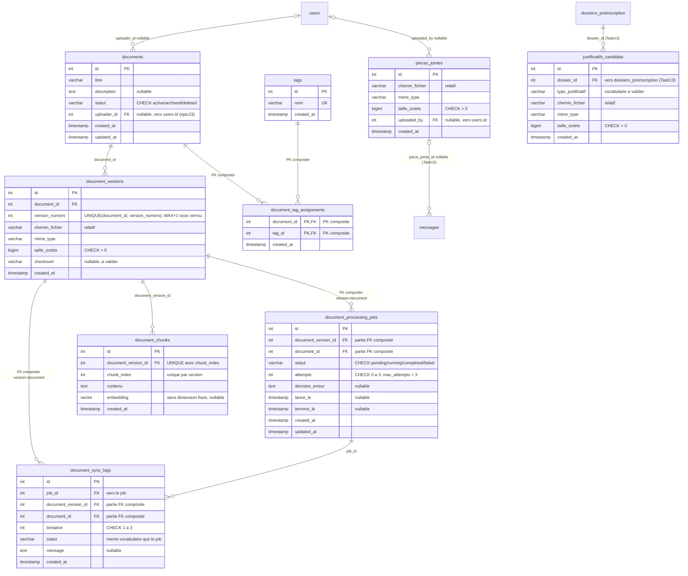

# Task14 — Conception de la gestion documentaire

| Métadonnée | Valeur |
|---|---|
| **Épic** | US15 — Données et documents (volet documentaire et RAG) |
| **Tâche** | Task14 — Conception de la gestion documentaire |
| **Statut du document** | Proposition finale soumise à validation |
| **Date** | 2026-11-12 |
| **Type** | Document de conception (aucune exécution SQL, aucune migration, aucune modification de base) |
| **Dépôt** | `SmartCampus-AI` (branche courante `feature/epic-10-nourcine`) |
| **Documents voisins** | `docs/Task12_Catalogue_Academique.md` (catalogue), `docs/Task13_Utilisateurs_Candidatures.md` (utilisateurs et candidatures) |

---

## 1. Présentation et périmètre

### 1.1 Objectif

Task14 pose la **conception documentaire du domaine documents et pièces jointes** : entités documentaires, versions immuables, traitement asynchrone (jobs), découpage vectoriel (chunks), journalisation des synchronisations, étiquetage, pièces jointes de conversation et justificatifs de dossier.

### 1.2 Entités couvertes

`documents`, `document_versions`, `document_processing_jobs`, `document_chunks`, `document_sync_logs`, `tags`, `document_tag_assignments`, `pieces_jointes`, `justificatifs_candidats`.

**Dépendances externes (non redéfinies ici) :** `users` (branche `epic23`, voir Task13 § 4.1), `dossiers_preinscription` (Task13 § 4.4), `messages` (branche `epic23`, voir Task13 § 4.7), `programmes` (Task12).

### 1.3 Périmètre exclus

- **Mécanismes JWT, sessions, `guest_sessions`, `get_current_user`, `require_role`** → **US27** (branche `epic23`, hors périmètre de ce document).
- **Catalogue académique** (`programmes`, `specialites`, `matieres`…) → Task12 : périmètre disjoint, **aucune table commune**.
- **Identités, dossiers, conversations** → Task13 : Task14 ne redéfinit ni `users`, ni `dossiers_preinscription`, ni `messages`.
- **Aucune exécution de SQL**, aucune migration, aucune modification de `db/init.sql`, de la base, du code API ou du frontend.
- **Aucun job runner imposé** : pas de Celery, pas de Redis, **aucun fournisseur cloud imposé**.

### 1.4 Convention de lecture

| Mention | Signification |
|---|---|
| **EXISTANT** | Vérifié en base live ou sur la branche `origin/epic23-sessions-invites` (branche **non fusionnée**, constatée par `git ls-tree`/`git show`, sans checkout ni merge). |
| **PROPOSÉ** | Conception Task14 **à implémenter ultérieurement** — **n'existe pas encore** : ne doit jamais être présenté comme existant. |
| **US15 / US27** | Équipes d'implémentation respectives (données/documents / auth-session). |
| **À VALIDER** | Point ouvert soumis à l'équipe (Annexe A). |

---

## 2. État réel et éléments existants

### 2.1 Base live (conteneur `smartcampus-db`, PostgreSQL 16 + pgvector 0.8.7, lecture seule)

Le schéma `public` contient **exactement deux tables** : `programmes` et `candidats`.

**Aucune table du périmètre Task14 n'existe en base live** : pas de `documents`, `document_versions`, `document_processing_jobs`, `document_chunks`, `document_sync_logs`, `tags`, `document_tag_assignments`, `pieces_jointes`, `justificatifs_candidats`.

| Constat | Détail |
|---|---|
| Extension `vector` | **EXISTANT** — `vector 0.8.7` installée en base (`pg_extension`) : l'infrastructure RAG est prête, **aucune colonne ni index vectoriel n'existe pour l'instant** |
| `db/init.sql` | **EXISTANT, intact** — ne contient que `CREATE TABLE IF NOT EXISTS programmes` et `candidats` |
| Recherche de code | **AUCUN HIT** sur `documents`, `document_versions`, `document_chunks`, `pieces_jointes`, `justificatifs_candidats` dans `backend/` et `db/` : rien n'est implémenté |
| Migrations | `backend/alembic/` **n'existe pas** sur la branche courante (aucun historique de migration local) |

### 2.2 Éléments de la branche `origin/epic23-sessions-invites` (NON FUSIONNÉE)

> ⚠️ **Cette branche n'est pas fusionnée dans la branche courante `feature/epic-10-nourcine`** (constaté par `git branch -a` + `git ls-tree`, sans checkout). Elle porte `backend/alembic/versions/0b68f51fe976_creation_des_tables_epic23.py` et les modèles `user.py`, `conversation.py`, `message.py`, `guest_session.py`, `conversation_profile.py`.

Éléments **réutilisés par Task14 sans les réécrire** :

| Élément | Usage dans Task14 |
|---|---|
| `users.id` (**INTEGER** PK, `email` UNIQUE NOT NULL) | Cible de `documents.uploader_id` et `pieces_jointes.uploaded_by` — **types FK `INTEGER` conformes** |
| `messages` (INTEGER PK, `conversation_id UUID`) | Cible de `messages.piece_jointe_id` (ajout **proposé par Task13**, décision 5) — la table n'est **pas recréée** |
| Système Alembic de la branche | Canal d'implémentation des futures migrations Task14 (§ 11, D14) |

### 2.3 Infrastructure et dépendances constatées (branche courante)

| Constat | Détail | Conséquence Task14 |
|---|---|---|
| `backend/requirements.txt` | FastAPI, SQLAlchemy ≥ 2.0, psycopg, pydantic — **aucun Celery, aucun Redis, aucun SDK cloud** (boto3, azure-storage, google-cloud absents) | **Pas de broker imposé** : l'exécution des jobs reste un choix d'implémentation (§ 8.7) |
| `docker-compose.yml` | Services `db`, `backend`, `frontend` uniquement — **pas de worker, pas de Redis** | Aucune infrastructure supplémentaire n'est requise par la conception |
| pgvector | Extension déjà active (§ 2.1) | Le stockage d'embeddings est possible **dès maintenant**, la stratégie d'index reste à choisir (§ 8.6) |

### 2.4 Points de vigilance

1. **Rien n'existe** : chaque table Task14 est **PROPOSÉ** — le document ne doit jamais laisser croire qu'une structure est déjà en place.
2. **Deux zones de dépendance** : `users`/`messages` viennent de la branche epic23 **non fusionnée** ; `dossiers_preinscription` vient de Task13 **proposé**. L'ordre d'implémentation en dépend (§ 10.3).
3. **Aucune dimension d'embedding n'est figée** : le modèle (et donc la dimension) reste configurable (§ 8.6).
4. **L'index vectoriel n'est ni choisi ni créé** : HNSW, IVFFlat ou absence d'index sont une décision de l'implémentation physique (§ 8.6, Annexe A).

---

## 3. Dictionnaire de données — vue d'ensemble

| # | Table | Statut | Rôle | PK |
|---|---|---|---|---|
| 1 | `documents` | **PROPOSÉ** | Document logique + cycle de vie | `id` INTEGER |
| 2 | `document_versions` | **PROPOSÉ** | Versions **immuables** d'un document | `id` INTEGER |
| 3 | `document_processing_jobs` | **PROPOSÉ** | File de traitement (pending/running/completed/failed) | `id` INTEGER |
| 4 | `document_chunks` | **PROPOSÉ** | Fragments + embedding pour le RAG | `id` INTEGER |
| 5 | `document_sync_logs` | **PROPOSÉ** | Journal des synchronisations et tentatives | `id` INTEGER |
| 6 | `tags` | **PROPOSÉ** | Étiquettes d'étiquetage | `id` INTEGER |
| 7 | `document_tag_assignments` | **PROPOSÉ** | Relation N:N documents ↔ tags | **composite `(document_id, tag_id)`** |
| 8 | `pieces_jointes` | **PROPOSÉ** | Pièce jointe de conversation (**distincte de `documents`**) | `id` INTEGER |
| 9 | `justificatifs_candidats` | **PROPOSÉ** | Justificatif rattaché à un dossier de préinscription | `id` INTEGER |
| — | `users` | **externe epic23** | Cible des FK `uploader_id` / `uploaded_by` | `id` INTEGER |
| — | `dossiers_preinscription` | **externe Task13** | Cible de `justificatifs_candidats.dossier_id` | `id` INTEGER |
| — | `messages` | **externe epic23** | Porteur de l'ajout `piece_jointe_id` (Task13) | `id` INTEGER |

**Conventions communes (alignées Task12/Task13) :** ASCII `snake_case` strict, types PostgreSQL standards, statuts en `VARCHAR + CHECK` (**pas d'ENUM PG**), timestamps `TIMESTAMPTZ DEFAULT now()`, PK `SERIAL INTEGER`, FK typées sur le type exact de la PK cible (`INTEGER → INTEGER`).

**Identifiants :** toutes les PK et FK du périmètre sont `INTEGER` (les seules cibles sont `users.id`, `dossiers_preinscription.id`, `messages.id`, toutes `INTEGER`) — **aucun UUID dans Task14**.

---

## 4. Spécification détaillée par table

> Aucun bloc de SQL exécutable : les contraintes sont décrites en tableaux ; l'implémentation revient à US15 selon § 10.3.

### 4.1 `documents` — PROPOSÉ

| Colonne | Type | Nullable | PK | FK |
|---|---|---|---|---|
| `id` | `INTEGER` | NON | ✅ | — SERIAL |
| `titre` | `VARCHAR(255)` | NON | — | — |
| `description` | `TEXT` | OUI | — | — |
| `statut` | `VARCHAR(20)` | NON | — | — défaut `'active'`, **CHECK `IN ('active','archived','deleted')` — cycle de vie à 3 états (décision 1)** |
| `uploader_id` | `INTEGER` | **OUI** | — | ✅ → `users.id` (INTEGER conforme, epic23) |
| `created_at` | `TIMESTAMPTZ` | NON | — | — `now()` |
| `updated_at` | `TIMESTAMPTZ` | NON | — | — `now()` |

| Contrainte | Définition |
|---|---|
| PK | `(id)` |
| CHECK | `statut IN ('active','archived','deleted')` |
| FK | `uploader_id → users.id` (**nullable** : un document peut être issu d'une importation sans compte identifié) |
| **Pas de colonne `document_count`** | **valeur calculée, jamais stockée** (§ 7, R7) |

### 4.2 `document_versions` — PROPOSÉ (immuabilité)

| Colonne | Type | Nullable | PK | FK |
|---|---|---|---|---|
| `id` | `INTEGER` | NON | ✅ | — SERIAL |
| `document_id` | `INTEGER` | NON | — | ✅ → `documents.id` |
| `version_numero` | `INTEGER` | NON | — | — **CHECK `>= 1`**, calculé `MAX + 1` sous verrou (§ 8.2, S2) |
| `chemin_fichier` | `VARCHAR(500)` | NON | — | — **chemin RELATIF** (§ 9) |
| `mime_type` | `VARCHAR(100)` | NON | — | — |
| `taille_octets` | `BIGINT` | NON | — | — CHECK `> 0` |
| `checksum_sha256` | `CHAR(64)` | OUI | — | — empreinte de contrôle, *à valider* (Annexe A6) |
| `created_at` | `TIMESTAMPTZ` | NON | — | — `now()` |

| Contrainte | Définition |
|---|---|
| PK | `(id)` |
| **UNIQUE** | **`(document_id, version_numero)`** — unicité de la version dans le document (décision 2) |
| **UNIQUE (appui)** | **`(id, document_id)`** — **nécessaire comme cible de la FK composite** des jobs et des logs (décision 3) |
| FK | `document_id → documents.id`, **ON DELETE RESTRICT** recommandé : on ne supprime pas physiquement un document qui porte des versions (§ 7, R11) |
| CHECK | `version_numero >= 1`, `taille_octets > 0` |

**Immuabilité (décision 2) :** une version **ne se modifie jamais** (ni contenu, ni chemin, ni numéro) ; toute correction produit une **nouvelle version**. Aucune colonne de type `updated_at` : sa présence suggérerait une mise à jour.

### 4.3 `document_processing_jobs` — PROPOSÉ (traitement)

| Colonne | Type | Nullable | PK | FK |
|---|---|---|---|---|
| `id` | `INTEGER` | NON | ✅ | — SERIAL |
| `document_version_id` | `INTEGER` | NON | — | ✅ **partie de la FK composite** |
| `document_id` | `INTEGER` | NON | — | ✅ **partie de la FK composite** |
| `statut` | `VARCHAR(20)` | NON | — | — défaut `'pending'`, **CHECK `IN ('pending','running','completed','failed')` — jamais `retry` (décision 4)** |
| `attempts` | `INTEGER` | NON | — | — défaut `0`, **CHECK `>= 0 AND <= 3`** (`max_attempts = 3`, décision 5) |
| `derniere_erreur` | `TEXT` | OUI | — | — message d'échec, NULL tant que non échoué |
| `lance_le` | `TIMESTAMPTZ` | OUI | — | — |
| `termine_le` | `TIMESTAMPTZ` | OUI | — | — |
| `created_at` / `updated_at` | `TIMESTAMPTZ` | NON | — | — `now()` |

| Contrainte | Définition |
|---|---|
| PK | `(id)` |
| **FK composite** | **`(document_version_id, document_id) → document_versions(id, document_id)`** — **garantit que la version citée appartient bien au document cité** (décision 3) ; remplace toute FK simple vers `document_versions.id` |
| CHECK | `statut` dans les 4 valeurs ; `attempts BETWEEN 0 AND 3` |
| Règle applicative | **`max_attempts = 3` est une constante métier** (§ 7, R6) : pas de colonne `max_attempts` (évite deux sources de vérité) |

**Note de typage :** `document_id` et `document_version_id` sont `INTEGER`, conformes à `document_versions.id` et `document_versions.document_id`.

### 4.4 `document_chunks` — PROPOSÉ (RAG)

| Colonne | Type | Nullable | PK | FK |
|---|---|---|---|---|
| `id` | `INTEGER` | NON | ✅ | — SERIAL |
| `document_version_id` | `INTEGER` | NON | — | ✅ → `document_versions.id` (**rattachement à une version, jamais au document**) |
| `chunk_index` | `INTEGER` | NON | — | — CHECK `>= 0`, **UNIQUE avec la version** (décision 6) |
| `contenu` | `TEXT` | NON | — | — |
| `embedding` | `vector` (**sans dimension figée**) | OUI | — | — rempli par le job ; **dimension définie par le modèle choisi** (§ 8.6) |
| `created_at` | `TIMESTAMPTZ` | NON | — | — `now()` |

| Contrainte | Définition |
|---|---|
| PK | `(id)` |
| **UNIQUE** | **`(document_version_id, chunk_index)`** — index unique **par version** (décision 6) |
| FK | `document_version_id → document_versions.id` (les chunks suivent la vie de leur version) |
| CHECK | `chunk_index >= 0` |
| **Index vectoriel** | **NI choisi NI créé à ce stade** — voir § 8.6 |

**Note de typage :** la colonne `embedding` est conceptuellement `vector` **sans dimension fixée** : la dimension (ex. 384, 768, 1536…) découle du modèle retenu à l'implémentation et **ne doit pas être verrouillée dans ce document**.

### 4.5 `document_sync_logs` — PROPOSÉ (journal)

| Colonne | Type | Nullable | PK | FK |
|---|---|---|---|---|
| `id` | `INTEGER` | NON | ✅ | — SERIAL |
| `job_id` | `INTEGER` | NON | — | ✅ → `document_processing_jobs.id` (**le log appartient à un job**) |
| `document_version_id` | `INTEGER` | NON | — | ✅ **partie de la FK composite** |
| `document_id` | `INTEGER` | NON | — | ✅ **partie de la FK composite** |
| `tentative` | `INTEGER` | NON | — | — **CHECK `>= 1 AND <= 3`** — numéro de la tentative journalisée |
| `statut` | `VARCHAR(20)` | NON | — | — **même vocabulaire que le job** : `IN ('pending','running','completed','failed')` |
| `message` | `TEXT` | OUI | — | — détail/erreur de la tentative |
| `created_at` | `TIMESTAMPTZ` | NON | — | — `now()` |

| Contrainte | Définition |
|---|---|
| PK | `(id)` |
| FK | `job_id → document_processing_jobs.id` |
| **FK composite** | **`(document_version_id, document_id) → document_versions(id, document_id)`** — **cohérence log ↔ version ↔ document** (décision 7) |
| CHECK | `tentative BETWEEN 1 AND 3` ; `statut` dans les 4 valeurs |
| Cohérence logique | `log.tentative <= job.attempts` et `log.document_id = job.document_id` : **règles inter-lignes, non exprimables en CHECK** → contrôle applicatif (Annexe A7) |

**Rôle :** chaque tentative de synchronisation laisse **une ligne immuable** — le journal n'est jamais mis à jour ni purgé (§ 7, R11).

### 4.6 `tags` — PROPOSÉ

| Colonne | Type | Nullable | PK | FK |
|---|---|---|---|---|
| `id` | `INTEGER` | NON | ✅ | — SERIAL |
| `nom` | `VARCHAR(50)` | NON | — | — **UNIQUE** |
| `created_at` | `TIMESTAMPTZ` | NON | — | — `now()` |

| Contrainte | Définition |
|---|---|
| PK | `(id)` |
| UNIQUE | `(nom)` — une étiquette = un libellé unique |

### 4.7 `document_tag_assignments` — PROPOSÉ (N:N)

| Colonne | Type | Nullable | PK | FK |
|---|---|---|---|---|
| `document_id` | `INTEGER` | NON | ✅ | ✅ → `documents.id` |
| `tag_id` | `INTEGER` | NON | ✅ | ✅ → `tags.id` |
| `created_at` | `TIMESTAMPTZ` | NON | — | — `now()` |

| Contrainte | Définition |
|---|---|
| **PK composite** | **`(document_id, tag_id)`** — association **unique** : impossible d'assigner deux fois la même étiquette (décision 8) |
| FK | `document_id → documents.id` ; `tag_id → tags.id` |

### 4.8 `pieces_jointes` — PROPOSÉ (table **distincte** de `documents`)

| Colonne | Type | Nullable | PK | FK |
|---|---|---|---|---|
| `id` | `INTEGER` | NON | ✅ | — SERIAL |
| `chemin_fichier` | `VARCHAR(500)` | NON | — | — **chemin RELATIF** (§ 9) |
| `mime_type` | `VARCHAR(100)` | NON | — | — |
| `taille_octets` | `BIGINT` | NON | — | — CHECK `> 0` |
| `uploaded_by` | `INTEGER` | **OUI** | — | ✅ → `users.id` (INTEGER conforme) |
| `created_at` | `TIMESTAMPTZ` | NON | — | — `now()` |

| Contrainte | Définition |
|---|---|
| PK | `(id)` |
| CHECK | `taille_octets > 0` |
| FK | `uploaded_by → users.id` (nullable) |
| **Aucune FK vers `documents`** | **décision 9** : `pieces_jointes` et `documents` sont **deux concepts disjoints** (pièce de conversation vs document versionné) |

**Usage (décision 9) :** cible de `messages.piece_jointe_id` — colonne **proposée par Task13** (§ 4.7 de ce document Task13) : **Task14 fournit la table, Task14 ne touche pas à `messages`**.

### 4.9 `justificatifs_candidats` — PROPOSÉ

| Colonne | Type | Nullable | PK | FK |
|---|---|---|---|---|
| `id` | `INTEGER` | NON | ✅ | — SERIAL |
| `dossier_id` | `INTEGER` | NON | — | ✅ → **`dossiers_preinscription.id` (Task13)** |
| `type_justificatif` | `VARCHAR(50)` | NON | — | — **vocabulaire à valider** (Annexe A3) |
| `chemin_fichier` | `VARCHAR(500)` | NON | — | — **chemin RELATIF** |
| `mime_type` | `VARCHAR(100)` | NON | — | — |
| `taille_octets` | `BIGINT` | NON | — | — CHECK `> 0` |
| `created_at` | `TIMESTAMPTZ` | NON | — | — `now()` |

| Contrainte | Définition |
|---|---|
| PK | `(id)` |
| FK | `dossier_id → dossiers_preinscription.id` (**cible définie en Task13 § 4.4, non redéfinie ici**) |
| CHECK | `taille_octets > 0` ; `type_justificatif` dans le vocabulaire validé (§ 7, R9) |
| **Aucun `candidat_id`** | **non redondant** : le candidat s'obtient par transit `justificatifs_candidats → dossiers_preinscription → candidats` (cohérent avec la décision 8 de Task13) |

---

## 5. Relations et cardinalités justifiées

| # | Relation | Cardinalité | Justification (FK réelle) |
|---|---|---|---|
| R1 | `users` → `documents` | **1:N (0..N)** | `documents.uploader_id` **nullable** (PROPOSÉ) |
| R2 | `documents` → `document_versions` | **1:N** | `document_versions.document_id NOT NULL` ; jamais 0 version utile, mais 0 possible à l'instant de création |
| R3 | `documents` ↔ `tags` | **N:N** | portée par `document_tag_assignments`, **PK composite** (décision 8) |
| R4 | `document_versions` → `document_processing_jobs` | **1:N** | FK **composite** `NOT NULL` : un job traite **exactement une version d'un document donné** (décision 3) |
| R5 | `document_versions` → `document_chunks` | **1:N** | `document_chunks.document_version_id NOT NULL` + `UNIQUE(version, chunk_index)` |
| R6 | `document_processing_jobs` → `document_sync_logs` | **1:N** | `document_sync_logs.job_id NOT NULL` : **au moins zéro log par job, un log par tentative** |
| R7 | `document_versions` → `document_sync_logs` | **1:N** | FK composite `NOT NULL` : chaque log pointe la version journalisée (cohérence § 4.5) |
| R8 | `dossiers_preinscription` → `justificatifs_candidats` | **1:N** | `justificatifs_candidats.dossier_id NOT NULL` (cible Task13) |
| R9 | `pieces_jointes` → `messages` | **1:0..N** | `messages.piece_jointe_id` **nullable** (PROPOSÉ **Task13**, dépendance réciproque § 10.2) |
| R10 | `users` → `pieces_jointes` | **1:N (0..N)** | `pieces_jointes.uploaded_by` **nullable** (PROPOSÉ) |
| R11 | `documents` → `document_sync_logs` | **indirecte** | atteint par transit `log → document_versions → documents` : **pas de FK directe** (le log porte déjà `document_id` dans sa FK composite, § 4.5) |
| R12 | `programmes` ↔ documents | **aucune** | **périmètre disjoint** : Task14 ne crée aucune FK vers Task12 (§ 10.1) |

**Justifications clés :** R2 = une nouvelle version est **ajoutée**, jamais une version existante remplacée ; R4/R7 = la double clé (version + document) empêche un job ou un log de mélanger deux documents ; R6 = traçabilité **par tentative** ; R9 = la pièce jointe vit dans la conversation, pas dans le dossier ; R12 = indépendance stricte des périmètres Task12/Task14.

---

## 6. Diagramme ERD Mermaid



**Légende de notation**

| Symbole | Signification |
|---|---|
| `\|\|` | exactement un (FK NOT NULL) |
| `\|o` (gauche) / `o\|` (droite) | zéro ou un (FK nullable) |
| `o{` | zéro ou plusieurs |
| `PK, FK` | colonne à la fois PK et FK (PK composite) |
| `UK` | colonne portant une contrainte UNIQUE |
| Mention `PROPOSE` / `Task13` / `epic23` | à implémenter / défini dans le document voisin / existant sur branche non fusionnée |

*Limites : les CHECK, l'UNIQUE d'appui `(id, document_id)` et les règles applicatives (tentatives, `max_attempts = 3`, immuabilité) font foi dans les tableaux de § 4. Les entités `users`, `dossiers_preinscription` et `messages` apparaissent **sans bloc d'attributs** : elles sont référencées mais volontairement **non redéfinies** ici — leurs définitions complètes figurent dans Task13 / sur la branche epic23.*

---

## 7. Règles métier et cycle de vie

| # | Règle | Niveau | Défense |
|---|---|---|---|
| **R1** | Un document a **exactement 3 états** : `active` → `archived` → `deleted` (suppression **logique**) | **DB** — CHECK `documents.statut` | § 4.1, décision 1 |
| **R2** | Archiver ou supprimer logiquement **ne détruit ni les versions, ni les chunks, ni les jobs, ni les journaux** : la conservation est intégrale | **DB** (absence de DELETE + `RESTRICT`) + applicatif | § 4.2, § 7 R11, décision 10 |
| **R3** | Une version est **immuable** : jamais de UPDATE sur son contenu ; toute correction = **nouvelle version** | Applicatif + conception (pas d'`updated_at`) | § 4.2, décision 2 |
| **R4** | `version_numero` est calculé **`MAX(version_numero) + 1` dans une transaction protégée contre les accès concurrents** (`SELECT ... FOR UPDATE` sur la ligne `documents`, ou équivalent) — l'UNIQUE est un filet, **pas la protection principale** | **DB** (UNIQUE) + **transaction applicative** | § 8.2 S2, décision 11 |
| **R5** | Un job traite **une version d'un document** : la **FK composite** garantit la cohérence document/version | **DB** | § 4.3, décision 3 |
| **R6** | Statuts de job : `pending`, `running`, `completed`, `failed` — **jamais `retry`**. En cas d'échec : **incrémenter `attempts`**, puis **remettre `pending` si `attempts < max_attempts` (3)**, sinon **`failed`** | **DB** (CHECK) + machine à états applicative | § 4.3, § 8.4 S4, décisions 4–5 |
| **R7** | **`document_count` est une valeur calculée** (`COUNT(document_versions)` à la lecture) : **jamais une colonne stockée** | Applicatif/vue | § 4.1, décision 12 |
| **R8** | Un chunk appartient à **une version** ; `(document_version_id, chunk_index)` est unique | **DB** — UNIQUE | § 4.4, décision 6 |
| **R9** | Chaque tentative de synchronisation laisse **un log immuable** rattaché à son job **et** à sa version | **DB** — FK simple + FK composite | § 4.5, décision 7 |
| **R10** | Un justificatif est rattaché à **un dossier** ; le candidat s'obtient **par transit** (pas de `candidat_id` redondant) | **DB** | § 4.9, décision 13 |
| **R11** | **Aucune purge** : ni des versions, ni des journaux, après archivage ou suppression logique ; la suppression physique d'un document porteur de versions est **bloquée** (`RESTRICT`) | **DB** + politique de conservation | § 4.2, décision 10 |
| **R12** | Le stockage se fait en **chemins relatifs** (jamais d'absolu, jamais de secret dans un chemin) | Convention | § 9, décision 15 |
| **R13** | La **synchronisation est événementielle** : déclenchée à la **création d'une nouvelle version**, pas par cron | Applicatif | § 8.5, décision 16 |
| **R14** | Ni Celery/Redis, ni fournisseur cloud **imposés** ; le modèle et la dimension d'embedding sont **configurables** ; l'**index vectoriel reste à décider** | Politique de conception | § 8.6–§ 8.7, décisions 17–19 |
| **R15** | `messages.piece_jointe_id` (Task13) impose **`pieces_jointes` créée avant** l'ALTER de `messages` | Plan d'exécution US15 | § 10.3 |

**Cycle de vie du document (vue d'états)**

```
active ──archive──▶ archived ──suppression logique──▶ deleted
  │                    │                                  │
  └────────────────────┴──── versions, chunks, jobs et logs TOUJOURS CONSERVÉS ────┘
```

**Cycle de vie du job (vue d'états)**

```
pending ──démarrage──▶ running ──succès──▶ completed
   ▲                     │
   │                     └──échec──▶ attempts = attempts + 1
   │                                   ├─ attempts < 3  ──▶ pending   (reprogrammé)
   └───────────────────────────────────┴─ attempts >= 3 ──▶ failed    (terminal)
```

---

## 8. Stratégie de traitement et synchronisation

### 8.1 Périmètre fonctionnel

Le « traitement » Task14 recouvre : extraction du texte, découpage en chunks, calcul des embeddings, indexation vectorielle et synchronisation du stockage. **Aucune de ces étapes n'est encore implémentée.**

### 8.2 Scénarios clés

**S1 — Création d'une version (événement déclencheur)**

1. L'application écrit le fichier en **chemin relatif** (§ 9).
2. Dans **une transaction**, elle verrouille la ligne `documents` concernée (`SELECT ... FOR UPDATE`), calcule `version_numero = COALESCE(MAX(version_numero), 0) + 1`, insère `document_versions`, puis crée **le job `pending`** et commit.
3. La **contrainte UNIQUE `(document_id, version_numero)`** reste en filet : en cas de course résiduelle, l'insertion échoue et l'opération est **rejouée**, jamais silencieusement corrompue.

> **Point technique obligatoire :** le `MAX + 1` **doit** s'exécuter dans une transaction protégée contre les accès concurrents. L'UNIQUE **seule est insuffisante** : elle détecte le conflit après coup (erreur) sans garantir que deux transactions concurrentes ne partent pas du même MAX.

**S3 — Enfilage** : le job est créé `pending` ; aucun worker n'est imposé (§ 8.7).

**S4 — Exécution** : passage `pending → running` (avec `lance_le`), traitement, puis `completed` (`termine_le`) ou échec.

**S5 — Échec et tentatives (règle obligatoire)**

```
sur échec :
    attempts := attempts + 1
    si attempts < max_attempts (3) : statut := 'pending'   ← reprogrammé
    sinon                          : statut := 'failed'    ← terminal
```

`derniere_erreur` renseigné à chaque échec ; **`retry` n'existe pas comme statut**.

**S6 — Journalisation** : **chaque tentative** écrit une ligne `document_sync_logs` (`tentative` = 1..3, `statut` repris du job, `message` = détail), rattachée par `job_id` **et** par la FK composite version+document.

**S7 — Synchronisation événementielle** : déclenchée **à la création d'une nouvelle version** (événement applicatif). **Aucun cron, aucun planificateur imposé.**

### 8.3 Cohérence job / version / log

| Garantie | Mécanisme |
|---|---|
| Le job porte la bonne version **du bon document** | FK **composite** `(document_version_id, document_id) → document_versions(id, document_id)` |
| Le log porte la même version que son job | FK composite identique + `job_id` NOT NULL |
| `log.tentative <= job.attempts` | **Contrôle applicatif** (règle inter-lignes, Annexe A7) |
| `log.document_id = job.document_id` | Découlant de la FK composite (même couple) + contrôle applicatif |

### 8.4 Machine à états des jobs

`pending → running → completed | (échec → pending si attempts < 3, sinon failed)`. Toute transition est **auditable** par les logs. `completed` et `failed` sont **terminaux**.

### 8.5 Synchronisation événementielle

Événement : **« nouvelle version créée »** → création/actualisation du job associé. Aucune resynchronisation périodique n'est conçue ici ; une resynchronisation manuelle éventuelle = **nouveau job** (et non la réouverture d'un job `failed`).

### 8.6 Modèle et dimension d'embedding — à décider

| Point | Position de Task14 |
|---|---|
| Modèle d'embedding | **Configurable** — aucune marque, aucun modèle imposé |
| Dimension | **Non fixée conceptuellement** : colonne `vector` sans dimension dans la conception ; la dimension réelle sera choisie **avec le modèle** |
| Index vectoriel | **NI choisi NI créé** : HNSW, IVFFlat ou absence d'index sont une décision de l'**implémentation physique**, en fonction de la dimension et du volume |
| Extension | `vector 0.8.7` **déjà installée** (EXISTANT) — aucun travail d'installation à prévoir |

> **Aucune affirmation du type « index HNSW en place » n'est acceptable** : à ce stade, **aucun index vectoriel n'a été choisi, créé ni testé**.

### 8.7 Exécution : sans broker imposé

Ni Celery, ni Redis, ni cloud dans `requirements.txt` ni dans `docker-compose.yml` (§ 2.3). Options laissées à l'équipe : exécution **synchronisée après création de version**, **thread/queue applicative**, ou ajout volontaire d'un worker **ultérieur**. **Task14 n'impose aucune de ces options.**

---

## 9. Sécurité et stockage

| Sujet | Règle |
|---|---|
| **Chemins relatifs** | `chemin_fichier` est **toujours relatif** à une racine configurable (ex. `documents/…`, `pieces/…`, `justificatifs/…`). **Jamais de chemin absolu** ni de variable d'environnement dans la colonne. |
| **Pas de secret** | Aucun identifiant d'accès, clé ou URL signée stocké dans les colonnes de chemin ; les secrets restent dans la configuration serveur (jamais affichés, jamais écrits en base). |
| **Aucun fournisseur cloud imposé** | Le stockage peut rester local (volume Docker `postgres_data`/backend) ou migrer vers un objet distant : le chemin relatif rend la migration neutre. |
| **Pas de quota, pas de purge** | Aucun quota de taille ni nettoyage automatique n'est conçu (décision 10 : conservation intégrale). |
| **Contrôle d'accès** | L'authentification et les rôles (`users.role`, `get_current_user`, `require_role`) relèvent de **US27** — hors périmètre ; Task14 ne conçoit aucune ACL. |
| **Intégrité des fichiers** | `checksum_sha256` (optionnel, Annexe A6) permet de vérifier la non-altération d'une version. |
| **Validation des types** | `mime_type` et `taille_octets` (`> 0`) contrôlent la nature et le poids des fichiers ; la validation métier fine (extensions autorisées) reste applicative. |

---

## 10. Compatibilité avec Task12 et Task13

### 10.1 Vers Task12 (`docs/Task12_Catalogue_Academique.md`)

| Point | Vérification |
|---|---|
| Périmètre | ✅ **disjoint** : Task12 déclare lui-même « aucune table commune, aucune contrainte croisée » (Task12 § 10) — Task14 **ne crée aucune FK vers `programmes`** |
| Conventions | ✅ `snake_case` ASCII, types PG standards, statuts `VARCHAR + CHECK`, timestamps `now()` — aligné |
| pgvector | ✅ Task12 cite pgvector « sans interaction requise » — confirmé : **aucune interaction** entre le catalogue et le RAG |
| Lecture métier | ✅ un document **n'appartient pas** à une formation dans la conception actuelle ; un éventuel lien futur serait une évolution à décider (Annexe A9) |

### 10.2 Vers Task13 (`docs/Task13_Utilisateurs_Candidatures.md`)

| Point | Vérification |
|---|---|
| `pieces_jointes` | ✅ **définie ici** (§ 4.8) avec exactement les colonnes attendues par Task13 § 4.7 : `id`, chemin relatif, `mime_type`, `taille`, `uploaded_by → users.id`, `created_at` — **une seule définition, aucune double vérité** |
| `messages.piece_jointe_id` | ✅ ajouter **proposé par Task13** (décision 5) : **Task14 ne modifie pas `messages`**, il fournit la cible ; type `INTEGER` = type de PK `pieces_jointes.id` → **conforme** (décision 7 de Task13) |
| `justificatifs_candidats` | ✅ FK `dossier_id → dossiers_preinscription.id` : la cible est **créée en Task13 § 4.4** ; la relation 1:N est **portée par Task14** et **référencée sans redéfinition** dans Task13 § 4.4/§ 9.2 |
| `users` | ✅ **même table existante epic23** (`documents.uploader_id`, `pieces_jointes.uploaded_by`) : aucun utilisateur créé deux fois ; FK `INTEGER` conformes |
| Pas de `candidat_id` redondant | ✅ transit `justificatif → dossier → candidat`, cohérent avec la décision 8 de Task13 |
| Double définition de `dossiers_preinscription` | ✅ définie **une seule fois** (Task13) ; Task14 ne la redéfinit pas |
| Ordre d'implémentation | ✅ aligné avec Task13 § 9.3 : `users` (fusion epic23) → `dossiers_preinscription` → **`pieces_jointes` (Task14)** → ALTER `messages` → tables Task14 restantes |

### 10.3 Ordre de cohérence des implémentations (US15)

1. **Fusionner/aligner la branche epic23** (base de `users`/`messages`) via Alembic — **jamais en modifiant `db/init.sql`**.
2. Créer `dossiers_preinscription` (**Task13**) — cible de § 4.9.
3. Créer **`pieces_jointes` (Task14, § 4.8)** puis ALTER `messages` (+ `piece_jointe_id`, **proposé Task13**).
4. Créer `documents` → `document_versions` → `tags` / `document_tag_assignments`.
5. Créer `document_processing_jobs` (FK composite), `document_chunks`, `document_sync_logs`.
6. Créer `justificatifs_candidats`.
7. Ajouter les **index** de § 11.2 ; **index vectoriel = décision d'implémentation physique distincte** (§ 8.6).

---

## 11. Décisions et justifications

### 11.1 Décisions de conception

| # | Décision | Justification technique |
|---|---|---|
| **D1** | Cycle de vie `documents` limité à **`active`, `archived`, `deleted`** | 3 états suffisent à modéliser usage, archivage et suppression **logique** ; un état de plus (ex. `draft`) ajouterait des transitions sans contrepartie. Le CHECK verrouille le vocabulaire en base |
| **D2** | `document_versions` **immuables** + `UNIQUE(document_id, version_numero)` | Le document « file de versions » n'a de sens que si l'historique est fiable : pas d'UPDATE = pas de piste d'audit falsifiable ; l'UNIQUE interdit le doublon de numéro dans un document |
| **D3** | **FK composite `(document_version_id, document_id)`** vers `document_versions(id, document_id)` (+ UNIQUE d'appui) | Une FK simple sur `document_version_id` **seule** permettrait d'associer une version du document A à un job déclaré sur le document B : la double clé **ferme cette brèche en base**, sans trigger |
| **D4** | Statuts de job : **`pending`, `running`, `completed`, `failed`** — **jamais `retry`** | `retry` décrirait une *action*, pas un *état* : la réessayer est portée par le compteur `attempts` + le retour à `pending`. 4 états = machine à états claire et terminal `failed` |
| **D5** | **`max_attempts = 3`** : échec → `attempts + 1` → `pending` si `< 3`, sinon `failed` | Boucle bornée : évite les jobs en échec infini qui saturent la file ; 3 tentatives = compromis standard essai/ressai. Constante métier (pas de colonne) = source unique de vérité |
| **D6** | Chunks rattachés à la **version** + `UNIQUE(document_version_id, chunk_index)` | Le contenu indexé dépend d'une version précise : rattachement au document mélangerait des textes de versions différentes ; l'UNIQUE évite le doublon de fragment (et le re-indexage inutile) |
| **D7** | `document_sync_logs` avec `job_id` **et** FK composite version+document | « Cohérence des logs avec le job et la version » : le log doit être rattachable au job (tentative) **et** à la version traitée (impact), sinon le journal ne prouve rien |
| **D8** | `document_tag_assignments` : **PK composite `(document_id, tag_id)`** | L'association N:N est le fait métier : pas de surrogate redondant, double assignation impossible par construction, jointures directes sur l'index de PK |
| **D9** | **`pieces_jointes` distincte de `documents`**, utilisée par `messages` | Deux sémantiques différentes : pièce jointe de conversation (jeton simple) vs document versionné (historique + RAG). Fusionner les deux ferait porter un cycle de vie de conversation à un document et inversement |
| **D10** | **Conservation intégrale** des versions, chunks, jobs et journaux après archivage/suppression logique ; `RESTRICT` sur la suppression physique | La valeur du RAG et de l'audit réside dans l'historique : purger après archivage rendrait `archived` et `deleted` destructeurs. `RESTRICT` traduit cette politique **en base** |
| **D11** | `version_numero = MAX + 1` **sous verrou transactionnel** (`SELECT ... FOR UPDATE` ou équivalent) | L'UNIQUE détecte le conflit **après** coup et provoque une erreur ; le verrou sur la ligne `document` **sérialise** les créations concurrentes et garantit des numéros consécutifs sans erreur. Les deux sont complémentaires : verrou = prévention, UNIQUE = détection |
| **D12** | **`document_count` calculé, non stocké** | Un compteur dupliqué se dérègle (écritures concurrentes, suppressions) et impose un trigger ; `COUNT()` à la lecture est exact par construction et le volume (few versions/document) ne justifie pas la cache |
| **D13** | `justificatifs_candidats` → **`dossiers_preinscription`**, sans `candidat_id` | Réutilise la décision 8 de Task13 (transit plutôt que redondance) : une seule source de vérité pour l'appartenance du candidat, zéro risque de divergence |
| **D14** | Aucune modification de `messages` ni de `conversations` ; **dépendance externe déclarée** | Les tables existent sur epic23 (non fusionnée) : les réécrire casserait le travail d'un autre membre. Task14 fournit **la cible** (`pieces_jointes`), Task13 porte **l'ajout de colonne** |
| **D15** | **Chemins relatifs** partout | Rend le stockage portable (dev/prod/cloud), évite de fuiter la structure serveur en base et permet la migration de support sans UPDATE massif |
| **D16** | **Synchronisation événementielle** à la nouvelle version | L'événement exact qui change l'état à indexer est la création de version : un cron resynchroniserait inutilement et détecterait les changements en retard |
| **D17** | **Aucun Celery/Redis imposé** | Ni `requirements.txt` ni `docker-compose.yml` ne les contiennent (§ 2.3) : imposer un broker alourdirait le déploiement pour un besoin non encore mesuré ; la machine à états en base suffit à orchestrer |
| **D18** | **Aucun fournisseur cloud imposé** + modèle/dimension **configurables** | Neutralité d'infrastructure : le déploiement actuel est 100 % local ; figer un modèle d'embedding reviendrait à figer la dimension, donc la colonne et l'index |
| **D19** | **Index vectoriel à décider lors de l'implémentation physique** | HNSW (performant en lecture, mémoire élevée) vs IVFFlat (construit vite, dépend du `lists`) dépend de la dimension et du volume — **aucun choix n'est fait, aucun index n'existe** : trancher ici serait prétendre à un état non constaté |
| **D20** | Aucun SQL exécutable dans ce document | Livrable **documentaire** (garde-fou identique à Task12/Task13) : l'exécution revient à US15 avec son processus de revue |

### 11.2 Index recommandés

*Aucun index n'est créé ici — liste destinée à US15.*

| Table | Colonnes | Type | Pourquoi |
|---|---|---|---|
| `documents` | `(statut)` | btree partiel `WHERE statut <> 'deleted'` | Listes filtrées par cycle de vie |
| `documents` | `(uploader_id)` | btree | FK non indexée par PostgreSQL |
| `document_versions` | `(document_id, version_numero)` | **UNIQUE** (générée) | Double usage : unicité **et** lecture « toutes les versions d'un document » (préfixe `document_id`) |
| `document_versions` | `(id, document_id)` | **UNIQUE d'appui** (générée) | Cible obligatoire des FK composite (jobs, logs) |
| `document_processing_jobs` | `(statut)` partiel `WHERE statut IN ('pending','running')` | btree | File d'attente : le worker ne lit que les jobs ouverts |
| `document_processing_jobs` | `(document_id)` | btree | Historique de traitement d'un document |
| `document_chunks` | `(document_version_id, chunk_index)` | **UNIQUE** (générée) | Lecture séquentielle d'une version + anti-doublon |
| `document_chunks` | **index vectoriel** | **À DÉCIDER** | HNSW / IVFFlat / aucun — **voir § 8.6, aucune décision prise** |
| `document_sync_logs` | `(job_id, tentative)` | btree | Journal d'un job dans l'ordre des tentatives |
| `document_sync_logs` | `(document_id, created_at)` | btree | Historique de synchronisation d'un document |
| `document_tag_assignments` | `(tag_id)` | btree | 2ᵉ sens de la N:N (tags → documents), la PK ne couvre pas `tag_id` en tête |
| `pieces_jointes` | `(uploaded_by)` | btree | FK non indexée |
| `justificatifs_candidats` | `(dossier_id)` | btree | Justificatifs d'un dossier (Task13) |

---

## 12. Conclusion et critères de validation

### 12.1 Conclusion

Task14 livre la conception documentaire complète en **9 tables**, intégralement **PROPOSÉES** : la base live ne contient que `programmes` et `candidats`, et aucun code de gestion documentaire n'existe dans le dépôt. Le socle technique existe pourtant (pgvector 0.8.7 déjà installé), ce qui permet de concevoir le RAG sans préjuger du modèle ni de l'index. **L'ensemble des exigences techniques obligatoires de la tâche** — cycle de vie à 3 états, versions immuables, FK composite, statuts de job sans `retry`, `max_attempts = 3` et son arbre de décision, chunks indexés par version, dimension non figée, journalisation cohérente, chemins relatifs, synchronisation événementielle, absence de broker/cloud imposés, index vectoriel non tranché, conservation après suppression logique — est tracé dans les critères ci-dessous (V6 → V28).

### 12.2 Critères de validation

| # | Critère | Vérification |
|---|---|---|
| V1 | Fichier `docs/Task14_Gestion_Documentaire.md` créé, **aucun autre fichier modifié** | ✅ ce fichier |
| V2 | Présentation + périmètre + exclusions (US27, Task12, Task13) | ✅ § 1 |
| V3 | État réel : base live, branche epic23 **non fusionnée**, infra (pgvector, requirements, docker-compose) | ✅ § 2 |
| V4 | Dictionnaire des **9 tables** + 4 dépendances externes | ✅ § 3, § 4 |
| V5 | PK, FK, **types**, nullabilité, UNIQUE, CHECK par table | ✅ § 4.1 → § 4.9 |
| V6 | **Cycle de vie `active/archived/deleted`** uniquement | ✅ § 4.1 (CHECK), § 7 R1, D1 |
| V7 | **Versions immuables + `UNIQUE(document_id, version_numero)`** | ✅ § 4.2, D2 |
| V8 | **`document_version_id` obligatoire** dans les jobs | ✅ § 4.3 (`NOT NULL`) |
| V9 | **FK composite `(document_version_id, document_id)`** garantissant la cohérence document/version (+ UNIQUE d'appui `(id, document_id)`) | ✅ § 4.3, § 4.5, R5, D3 |
| V10 | Statuts job **`pending`, `running`, `completed`, `failed`** — **jamais `retry`** | ✅ § 4.3 (CHECK), § 7 R6, D4 |
| V11 | **`max_attempts = 3`** ; échec → `attempts+1` → `pending` si `< 3`, sinon `failed` | ✅ § 4.3, § 8.2 S5, § 7 R6, D5 |
| V12 | Chunks rattachés à **une version**, `chunk_index` **unique par version** | ✅ § 4.4, R8, D6 |
| V13 | **`embedding vector` sans dimension fixée** conceptuellement | ✅ § 4.4, § 8.6 |
| V14 | **`document_sync_logs`** = historique des synchronisations **et des tentatives** | ✅ § 4.5, R9, D7 |
| V15 | **Cohérence des logs avec le job et la version** (FK simple + FK composite + contrôles applicatifs) | ✅ § 4.5, § 8.3 |
| V16 | `document_tag_assignments` = **N:N documents ↔ tags** (PK composite) | ✅ § 4.6–§ 4.7, D8 |
| V17 | **`document_count` calculé, non stocké** | ✅ § 4.1, R7, D12 |
| V18 | **`pieces_jointes` distincte de `documents`**, utilisée par `messages` | ✅ § 4.8, D9 |
| V19 | **`justificatifs_candidats` liés à `dossiers_preinscription`** (sans `candidat_id`) | ✅ § 4.9, R10, D13 |
| V20 | **Stockage en chemins relatifs** | ✅ § 9, R12, D15 |
| V21 | **Synchronisation événementielle lors d'une nouvelle version** | ✅ § 8.2 S1/S7, § 8.5, R13, D16 |
| V22 | **Pas de Celery/Redis imposé** | ✅ § 2.3, § 8.7, R14, D17 |
| V23 | **Pas de fournisseur cloud imposé** | ✅ § 9, R14, D18 |
| V24 | **Modèle et dimension d'embedding configurables** | ✅ § 8.6, R14, D18 |
| V25 | **Index vectoriel à décider à l'implémentation physique** — **aucune prétention d'index choisi ou créé** | ✅ § 8.6, § 11.2, D19 |
| V26 | **Conservation des versions et journaux après archivage/suppression logique** | ✅ § 7 R2/R11, § 4.2 (RESTRICT), D10 |
| V27 | **`version_numero = MAX + 1` dans une transaction protégée** (SELECT FOR UPDATE ou équivalent) — **UNIQUE insuffisante seule** | ✅ § 8.2 S2, R4, D11 |
| V28 | **Échec : incrémenter `attempts`, `pending` si `< max_attempts`, sinon `failed`** | ✅ § 7 R6, § 8.2 S5, § 7 machine à états |
| V29 | Cohérence Task12 (périmètre disjoint) et Task13 (`pieces_jointes`, `justificatifs_candidats`, `users`, ordre d'implémentation) | ✅ § 10 |
| V30 | Séparation **EXISTANT / PROPOSÉ** — aucune structure proposée présentée comme existante | ✅ § 1.4, § 2, § 3 (statuts), § 12.1 |
| V31 | Décisions justifiées (D1→D20) + index recommandés (§ 11.2) | ✅ § 11 |
| V32 | **Aucun SQL exécutable**, aucune migration, `db/init.sql` intact, aucune API/modèle Python modifié, aucun commit | ✅ Annexe B |

### 12.3 Validation requise avant clôture

- Accord sur les points de l'**Annexe A** (vocabulaires, checksum, resynchronisation, index vectoriel, lien éventuel au catalogue).
- Prise de connaissance par **US15** (§ 10.3) ; **US27** reste propriétaire de l'authentification (§ 9).

---

## Annexe A — Points restant à valider par l'équipe

| # | Point | Position par défaut du document | Impact |
|---|---|---|---|
| A1 | Transitions exactes du cycle de vie (`active ⇄ archived` réversible ? `deleted` définitif ?) | 3 états CHECK, transitions applicatives libres hors `deleted` | Moyen |
| A2 | **Vocabulaire des statuts de job** confirmé : `pending/running/completed/failed` | tel quel (imposé par la tâche) | Faible |
| A3 | **Vocabulaire `type_justificatif`** (releve, diplome, piece_identite…) | colonne `VARCHAR(50)` **sans CHECK** tant que non validé | Moyen |
| A4 | **`max_attempts = 3`** : constante applicative ou future colonne | constante (§ 7 R6) | Faible |
| A5 | Retour à `pending` : **création d'un nouveau job** ou **réouverture du même** ? | réouverture du même job (attempts conservés) | Moyen |
| A6 | **`checksum_sha256`** : obligatoire ou optionnel ? algorithme ? | colonne **nullable** (optionnelle) | Faible |
| A7 | Contrôles inter-lignes `log.tentative <= job.attempts` et `log.document_id = job.document_id` : **où** (service, trigger) ? | contrôle **applicatif** (non exprimable en CHECK) | Moyen |
| A8 | **Modèle et dimension d'embedding**, puis **index vectoriel** (HNSW/IVFFlat/aucun) | **à décider à l'implémentation physique** — rien n'est choisi | **Élevé** — conditionne le schéma physique |
| A9 | Éventuel lien `documents → programmes` (documents pédagogiques) | **aucun lien** (périmètre disjoint, § 10.1) | Moyen |
| A10 | Racine de stockage et stratégie de rétention (pas de purge, pas de quota) | chemins relatifs, rétention illimitée | Moyen |
| A11 | Ordre réel de **fusion de la branche epic23** (conditionne `users` et `messages`) | fusion préalable supposée | **Élevé** — bloquant |
| A12 | Exécution des jobs : synchronisé / file applicative / worker ajouté | **aucun broker imposé** (§ 8.7) | Moyen |
| A13 | Endpoints API dédiés (`/api/documents`, `/api/pieces-jointes`…) | hors périmètre Task14, à arbitrer avec l'équipe API | Faible |

---

## Annexe B — Journal de conformité (contraintes de la tâche)

| Contrainte imposée | Constat |
|---|---|
| Vérifier `git status` avant opération | ✅ fait : modifications non commitées d'un autre membre identifiées (`M backend/app/main.py`, `?? backend/app/api/routes/formations.py`, `?? backend/app/schemas/`, `?? backend/app/services/`) et **non touchées** |
| Créer uniquement `docs/Task14_Gestion_Documentaire.md` si absent | ✅ **un seul fichier créé** — `Test-Path = False` avant écriture (aucun écrasement) ; Task12 et Task13 **inchangés** |
| Ne modifier aucune API, aucun modèle Python, aucune migration | ✅ `backend/` intact ; aucune migration créée ; `backend/alembic/` toujours absent de la branche courante |
| Ne pas toucher à `db/init.sql` ni à la base | ✅ `db/init.sql` inchangé (toujours 2 `CREATE TABLE`) ; base en **lecture seule** (`\dt`, `pg_extension` uniquement) |
| Ne pas toucher au travail des autres membres | ✅ aucun fichier tracké ni non tracké hors `docs/Task14_Gestion_Documentaire.md` modifié |
| Aucun commit, push ni merge ; aucun checkout de branche | ✅ aucun ; epic23 consulté par `git ls-tree` / `git show` **sans checkout** |
| Ne jamais afficher de secrets ni de contenu `.env` | ✅ aucun `.env` lu ni affiché ; aucun secret en base ni dans le document |
| Ne jamais écraser un fichier existant | ✅ vérification `Test-Path` préalable |
| Ne pas prétendre qu'une structure proposée existe | ✅ chaque table/portée marquée **EXISTANT** (avec sa source : live ou epic23) ou **PROPOSÉ** (§ 1.4, § 2, § 3) ; § 8.6 proclame explicitement l'**absence d'index vectoriel choisi** |
| Vérification finale : Mermaid, Markdown, relations, types FK/PK, références Task12/Task13 | ✅ critères V1→V32 ; Mermaid contrôlé contre la syntaxe officielle (clés `PK, FK` / `UK`, commentaires entre guillemets, cardinalités `\|\|`/`\|o`/`o{`, types `int`/`bigint`/`varchar`/`vector` conformes) |
